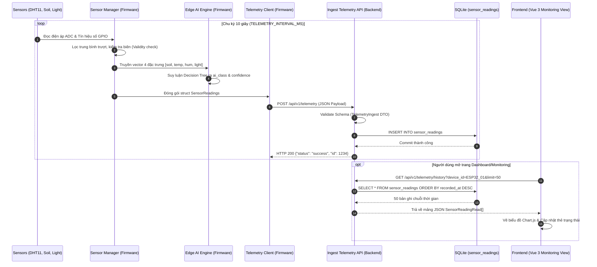
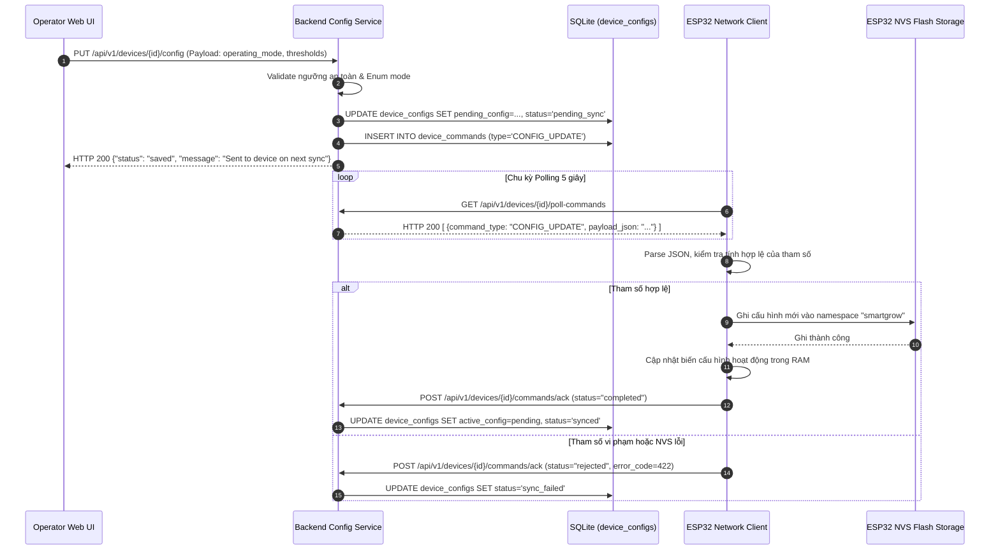
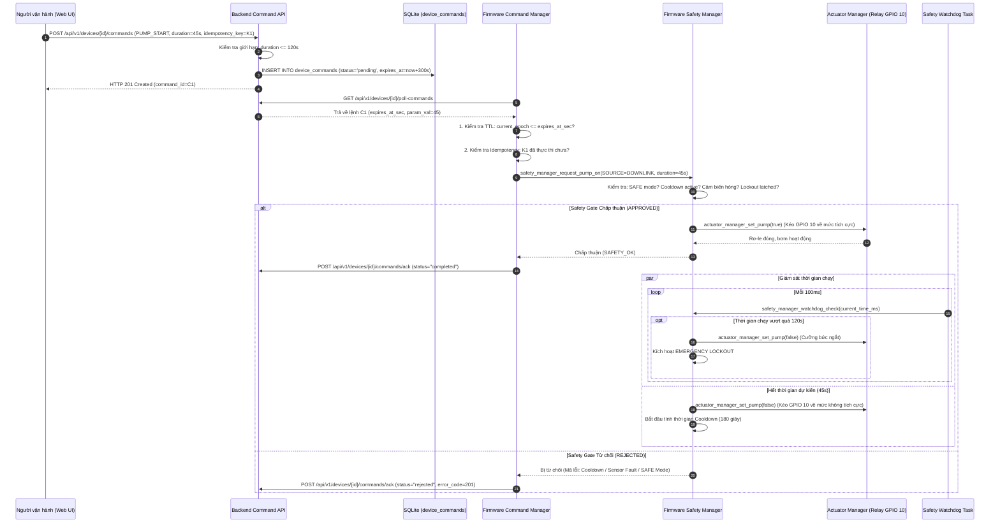

# KIẾN TRÚC HỆ THỐNG VÀ LUỒNG DỮ LIỆU XUYÊN TẦNG
*(SmartGrow AI — Architecture, Protocols & Cross-Layer Data Flow)*

> [!NOTE]
> **TÀI LIỆU THAM CHIẾU CHÍNH THỨC (Cập nhật Re-Audit 2026):**
> - Báo cáo kiểm toán toàn diện: [`docs/FULL_PROJECT_AUDIT.md`](file:///c:/Users/ADMIN/Downloads/smartgrow-ai/docs/FULL_PROJECT_AUDIT.md)
> - Sơ đồ chân GPIO & đấu nối phần cứng: [`docs/HARDWARE_WIRING_AND_GPIO.md`](file:///c:/Users/ADMIN/Downloads/smartgrow-ai/docs/HARDWARE_WIRING_AND_GPIO.md)
> - Hướng dẫn cấu hình tập trung firmware: [`docs/FIRMWARE_CONFIGURATION_GUIDE.md`](file:///c:/Users/ADMIN/Downloads/smartgrow-ai/docs/FIRMWARE_CONFIGURATION_GUIDE.md)
> - Chi tiết toàn trình Machine Learning: [`docs/ML_END_TO_END_GUIDE.md`](file:///c:/Users/ADMIN/Downloads/smartgrow-ai/docs/ML_END_TO_END_GUIDE.md)

---

## 1. BẢN ĐỒ VỊ TRÍ VÀ VAI TRÒ CÁC THÀNH PHẦN

| Thành phần | Đường dẫn thực tế | File Entry Point | Vai trò chính | Công nghệ & Runtime |
|---|---|---|---|---|
| **Frontend** | `frontend/` | `src/main.ts` | Giao diện quản trị, giám sát vi khí hậu, gửi lệnh điều khiển | Vue 3, Vite 5.4, Pinia, TypeScript |
| **Backend** | `backend/` | `app/main.py` | API RESTful, hàng đợi lệnh, xác thực, ingestion telemetry | FastAPI 0.119, SQLAlchemy 2.0, Python 3.11 |
| **Database** | `smartgrow.db` | `app/models/entities.py` | Lưu trữ dữ liệu quan hệ, lịch sử cảm biến, audit logs | SQLite 3 (ORM SQLAlchemy) |
| **Firmware** | `firmware/` | `src/main.c` | Lấy mẫu cảm biến, Edge AI, cổng an toàn, điều khiển tải | C99, FreeRTOS, ESP-IDF / PlatformIO |
| **ML Training** | `ml/training/` | `train_model.py` | Huấn luyện mô hình TinyML Decision Tree | Scikit-learn 1.9, Pandas, NumPy |
| **ML Transpiler** | `ml/export/` | `transpile_to_c.py` | Dịch cây quyết định sang mã nguồn C tĩnh thuần | Python AST to C code generator |
| **Edge AI Runtime** | `firmware/src/` | `edge_ai_model.c` | Suy luận thời gian thực tại biên (< 5 µs, 0 dynamic RAM) | Mã C tĩnh thuần, không phụ thuộc thư viện |
| **Native Tests** | `firmware/test/` | `test_firmware_native.c`| Giả lập phần cứng kiểm thử 287 ca kiểm thử firmware | MinGW-w64 GCC / Linux GCC |

---

## 2. SƠ ĐỒ LUỒNG DỮ LIỆU VÀ ĐIỀU KHIỂN (MERMAID)

### 2.1. Luồng Thu thập và Truy vấn Dữ liệu Cảm biến (Telemetry Pipeline)

---

### 2.2. Luồng Đồng bộ Cấu hình (Configuration Synchronization & ACK)

---

### 2.3. Luồng Lệnh Điều khiển Actuator và Cổng An toàn (Safety Interlocks)

---

## 3. BẢNG ĐỐI CHIẾU NHẤT QUÁN LIÊN TẦNG (CROSS-LAYER PARITY TABLES)

### 3.1. Chế độ điều khiển (Control Mode Mapping)

| Control Mode | Frontend Value | Backend Schema/DB | Downlink Payload | Firmware Enum (`ControlMode`) | Kết luận |
|---|---|---|---|---|---|
| **Tự động (AI)** | `"AUTO"` | `"AUTO"` (int: 0) | `"AUTO"` | `CONTROL_MODE_AUTO = 0` | **MATCH** |
| **Thủ công** | `"MANUAL"` | `"MANUAL"` (int: 1) | `"MANUAL"` | `CONTROL_MODE_MANUAL = 1` | **MATCH** |
| **Quy tắc cục bộ**| `"RULE"` | `"RULE"` (int: 2) | `"RULE"` | `CONTROL_MODE_RULE = 2` | **MATCH** *(Đã sửa)* |
| **Lai (AI + Rule)**| `"HYBRID"` | `"HYBRID"` (int: 3) | `"HYBRID"` | `CONTROL_MODE_HYBRID = 3` | **MATCH** *(Đã sửa)* |
| **An toàn khẩn cấp**| `"SAFE"` | `"SAFE"` (int: 4) | `"SAFE"` | `CONTROL_MODE_SAFE = 4` | **MATCH** |

*Ghi chú*: Trước khi audit, giao diện Frontend (`DevicesView.vue`) bị thiếu 2 tùy chọn `RULE` và `HYBRID`. Đã được bổ sung đồng bộ hoàn toàn với enum của Firmware.

---

### 3.2. Cấu trúc trường dữ liệu Telemetry (Telemetry Payload Parity)

| Trường dữ liệu | Payload Firmware (C Struct) | Backend Ingest DTO | Bảng Database (`sensor_readings`) | Frontend Hiển thị | Đơn vị & Miền giá trị | Kết luận |
|---|---|---|---|---|---|---|
| Mã thiết bị | `device_id` (char[32]) | `device_id: str` | `device_id VARCHAR(64)` | `d.device_id` | Chuỗi ký tự định danh | **MATCH** |
| Số thứ tự gói | `sequence` (uint32_t) | `sequence: int` | `sequence INTEGER` | `r.sequence` | Số nguyên tăng dần (0..2^32-1) | **MATCH** |
| Độ ẩm đất | `soil_moisture_pct` (float) | `soil_moisture_pct: float` | `soil_moisture_pct FLOAT` | `r.soil_moisture_pct` | `%` (0.0 .. 100.0) | **MATCH** |
| Nhiệt độ không khí| `temperature_c` (float) | `temperature_c: float` | `temperature_c FLOAT` | `r.temperature_c` | `°C` (-10.0 .. 60.0) | **MATCH** |
| Độ ẩm không khí | `humidity_pct` (float) | `humidity_pct: float` | `humidity_pct FLOAT` | `r.humidity_pct` | `%` (10.0 .. 95.0) | **MATCH** |
| Cường độ ánh sáng| `light_level_pct` (float) | `light_level_pct: float` | `light_level_pct FLOAT` | `r.light_level_pct` | `%` (0.0 .. 100.0) | **MATCH** |
| Lớp dự đoán AI | `ai_class` (char[24]) | `ai_class: str` | `ai_class VARCHAR(50)` | `r.ai_class` | NORMAL, NEED_WATER, etc. | **MATCH** |
| Độ tin cậy AI | `ai_confidence` (float) | `ai_confidence: float` | `ai_confidence FLOAT` | `r.ai_confidence` | `0.000 .. 1.000` | **MATCH** |
| Trạng thái bơm | `pump_state` (bool) | `pump_state: bool` | `pump_state BOOLEAN` | `r.pump_state` | `true` (ON), `false` (OFF) | **MATCH** |
| Chế độ vận hành | `operating_mode` (char[16]) | `operating_mode: str` | `operating_mode VARCHAR(50)`| `r.operating_mode` | Chuỗi enum chế độ | **MATCH** |

---

### 3.3. Các loại lệnh điều khiển (Command Types & Parameter Parity)

| Loại lệnh (`command_type`) | Tham số đi kèm | Hành vi trên Firmware | Ràng buộc an toàn phần cứng | Kết luận |
|---|---|---|---|---|
| `PUMP_START` | `param_val` hoặc `duration_s` (giây) | Kích hoạt Rơ-le (GPIO 10 -> active level) | Max 120s, Cooldown 180s, kiểm tra cảm biến | **MATCH** |
| `PUMP_STOP` | Không yêu cầu | Ngắt Rơ-le (GPIO 10 -> inactive level) | Cho phép thực thi ngay cả khi Lockout | **MATCH** |
| `VENT_SET` | `param_val` (góc mở 0..90 độ) | Điều khiển Servo cửa sổ thông gió | Giới hạn góc từ 0 đến 90 độ | **MATCH** |
| `BUZZER_BEEP` | `duration_s` (thời lượng kêu) | Phát âm thanh cảnh báo tại chỗ | Không ảnh hưởng đến máy bơm | **MATCH** |
| `CONFIG_UPDATE` | Cấu hình trong `payload_json` | Ghi đè cấu hình vào NVS Flash | Từ chối nếu tham số sai ngưỡng | **MATCH** |
| `RESTART` | Không yêu cầu | Ngắt tải an toàn và gọi `esp_restart()` | Luôn tắt bơm trước khi reboot | **MATCH** |

---

### 3.4. Thời gian, Múi giờ, Đồng bộ và TTL (Timing & Clock Parity)

| Khái niệm | Frontend | Backend | Firmware ESP32 | Cơ chế Fail-safe | Kết luận |
|---|---|---|---|---|---|
| **Chuẩn múi giờ** | Trình duyệt Client (Local / UTC) | UTC (`datetime.now(timezone.utc)`) | Unix Epoch (Seconds từ SNTP) | Toàn bộ lưu trữ DB và so sánh đều chuẩn hóa UTC | **MATCH** |
| **Command TTL** | Client chỉ định `ttl_s` (Mặc định 300s) | Lưu `expires_at` (Datetime UTC) | Nhận `expires_at_sec` (Unix Epoch) | Nếu SNTP chưa đồng bộ (`epoch == 0`), Firmware dựa vào bộ lọc server sweep | **MATCH** *(Đã sửa)* |
| **Sensor Sampling** | N/A (Chỉ hiển thị) | N/A (Lắng nghe thụ động) | `SENSOR_SAMPLE_INTERVAL_MS = 2000` | Lọc trung bình trượt 5 mẫu gần nhất | **MATCH** |
| **Telemetry Uplink**| N/A | Ingestion REST API | `TELEMETRY_INTERVAL_MS = 10000` | Đẩy định kỳ mỗi 10 giây | **MATCH** |
| **Command Polling** | N/A | Trả về danh sách `pending` | `COMMAND_POLL_INTERVAL_MS = 5000` | Kéo lệnh định kỳ mỗi 5 giây | **MATCH** |
| **Safety Watchdog**| N/A | N/A | `WATCHDOG_CHECK_INTERVAL_MS = 100` | Kiểm tra thời gian thực mỗi 100ms | **MATCH** |
