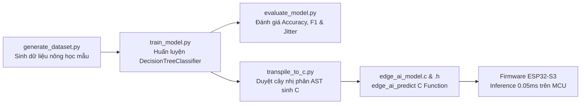

# SMARTGROW AI — TÀI LIỆU TOÀN DIỆN GIẢI THÍCH MÃ NGUỒN THEO TỪNG CHỨC NĂNG

> **Cẩm nang kỹ thuật chi tiết dành cho kỹ sư phát triển, tích hợp và bảo trì hệ thống**  
> **Bao phủ toàn diện 5 phân hệ:** Frontend (Vue 3/TS), Backend (FastAPI/Python), Database (SQLAlchemy/SQLite), Firmware (ESP32-S3/C), Machine Learning (TinyML C Transpiled)

---

## 1. PHÂN HỆ BACKEND API (FASTAPI & PYTHON 3.11)

### 1.1. Cấu trúc và Khởi tạo Ứng dụng
- **File:** [backend/app/main.py](file:///c:/Users/ADMIN/Downloads/smartgrow-ai/backend/app/main.py)
- **Cơ chế Lifespan (`@asynccontextmanager`):**
  1. `Base.metadata.create_all(bind=engine)`: Tự động khởi tạo cấu trúc bảng nếu chưa tồn tại.
  2. **Dynamic Migrations:** Thực hiện kiểm tra `PRAGMA table_info` và tự động bổ sung các cột mới mà không làm mất dữ liệu (`idempotency_key`, `soil_valid`, `dht_valid`, `light_valid`, tái tạo bảng `sensor_readings` và `ai_inference_events` an toàn bằng kỹ thuật copy-table).
  3. **Seed Initial Admin User:** Kiểm tra tài khoản `admin@smartgrow.local`. Nếu chưa có, tự động tạo tài khoản quản trị viên với mật khẩu đã băm Bcrypt.
  4. **Seed Default AI Model:** Tạo bản ghi metadata cho mô hình TinyML `v1.0.0-dt`.
  5. **Background Task (`periodic_device_health_checker`):** Vòng lặp bất đồng bộ mỗi 15 giây quét các thiết bị có `status == "online"` nhưng không có tín hiệu gửi về trong khoảng thời gian `DEVICE_HEARTBEAT_TIMEOUT_SECONDS` (60 giây), tự động chuyển sang trạng thái `offline`.

### 1.2. Bảng Danh mục Router & API Endpoints Thực tế

| HTTP Method | Endpoint | Router Module | Schema Request / Response | Bảng Database liên quan | Chức năng nghiệp vụ |
|---|---|---|---|---|---|
| `POST` | `/api/v1/auth/login` | `auth.py` | `OAuth2PasswordRequestForm` / `TokenResponse` | `users`, `audit_logs` | Xác thực đăng nhập, cấp JWT Access Token |
| `GET` | `/api/v1/auth/me` | `auth.py` | None / `UserRead` | `users` | Lấy thông tin cá nhân và quyền hạn người dùng hiện tại |
| `POST` | `/api/v1/auth/register` | `auth.py` | `UserCreate` / `UserRead` | `users`, `audit_logs` | Đăng ký tài khoản mới (Chỉ dành cho Admin) |
| `GET` | `/api/v1/auth/users` | `auth.py` | None / `List[UserRead]` | `users` | Danh sách tài khoản người dùng hệ thống |
| `GET` | `/api/v1/greenhouses` | `greenhouses.py` | None / `List[GreenhouseRead]` | `greenhouses` | Lấy danh sách nhà kính |
| `POST` | `/api/v1/greenhouses` | `greenhouses.py` | `GreenhouseCreate` / `GreenhouseRead` | `greenhouses`, `audit_logs` | Tạo nhà kính mới |
| `GET` | `/api/v1/zones` | `zones.py` | `greenhouse_id` (Query) / `List[ZoneRead]` | `zones` | Lấy danh sách zone theo nhà kính |
| `POST` | `/api/v1/zones` | `zones.py` | `ZoneCreate` / `ZoneRead` | `zones`, `audit_logs` | Tạo khu vực trồng trọt mới |
| `GET` | `/api/v1/devices` | `devices.py` | None / `List[DeviceRead]` | `devices` | Danh sách thiết bị phần cứng ESP32-S3 |
| `POST` | `/api/v1/devices/register`| `devices.py` | `DeviceRegistrationIn` / `DeviceRead` | `devices`, `device_configs` | Thiết bị tự đăng ký gia nhập mạng qua Registration Token |
| `PUT` | `/api/v1/devices/{id}/zone`| `devices.py` | `zone_id` (Query) / `DeviceRead` | `devices`, `audit_logs` | Gán thiết bị vào một Zone quản lý |
| `GET` | `/api/v1/devices/{dev_id}/poll-commands` | `devices.py` | None / `List[CommandOut]` | `device_commands` | ESP32-S3 định kỳ lấy danh sách lệnh điều khiển pending |
| `POST` | `/api/v1/devices/commands/ack` | `devices.py` | `CommandAckIn` / `StatusResponse` | `device_commands`, `irrigation_events` | ESP32-S3 gửi xác nhận kết quả thực thi lệnh (ACK) |
| `POST` | `/api/v1/telemetry` | `telemetry.py` | `TelemetryPayloadIn` / `TelemetryAck` | `sensor_readings`, `ai_inference_events`, `alerts` | Tiếp nhận gói tin đo đạc cảm biến và AI từ ESP32 |
| `GET` | `/api/v1/telemetry/history` | `telemetry.py` | `limit`, `device_id` / `List[TelemetryRead]` | `sensor_readings` | Lấy lịch sử đo đạc cảm biến phục vụ vẽ biểu đồ |
| `GET` | `/api/v1/telemetry/export` | `telemetry.py` | `start_date`, `end_date` / CSV Stream | `sensor_readings` | Xuất dữ liệu cảm biến ra file CSV |
| `POST` | `/api/v1/irrigation/start` | `irrigation.py` | `IrrigationStartIn` / `CommandResponse` | `device_commands`, `audit_logs` | Ra lệnh bật bơm nước (chặn $\le$ 120s an toàn) |
| `POST` | `/api/v1/irrigation/stop` | `irrigation.py` | `IrrigationStopIn` / `CommandResponse` | `device_commands`, `audit_logs` | Ra lệnh dừng tưới khẩn cấp |
| `GET` | `/api/v1/edge-ai/models/active` | `edge_ai.py` | None / `AIModelRead` | `ai_models` | Thông tin mô hình TinyML Decision Tree đang áp dụng |
| `GET` | `/api/v1/edge-ai/events` | `edge_ai.py` | `limit` / `List[AIEventRead]` | `ai_inference_events` | Danh sách sự kiện suy luận và can thiệp an toàn |
| `GET` | `/api/v1/alerts` | `alerts.py` | `severity`, `is_resolved` / `List[AlertRead]` | `alerts` | Danh sách cảnh báo sự cố hệ thống |
| `PUT` | `/api/v1/alerts/{id}/resolve`| `alerts.py` | None / `AlertRead` | `alerts`, `audit_logs` | Đánh dấu cảnh báo đã được giải quyết |
| `GET` | `/api/v1/analytics/dashboard-summary` | `analytics.py` | None / `DashboardSummaryRead` | `greenhouses`, `devices`, `alerts`, `sensor_readings` | Tổng hợp nhanh số liệu cho 4 thẻ thống kê Dashboard |
| `GET` | `/api/v1/system/audit-logs`| `system.py` | `limit`, `action` / `List[AuditLogRead]` | `audit_logs` | Truy vấn nhật ký bảo mật của hệ thống |

---

## 2. PHÂN HỆ FIRMWARE NHÚNG (ESP32-S3 / C NATIVE / FREE-RTOS)

### 2.1. Cấu trúc Luồng Điều khiển (Tasks Topology)
- **Task 1: Sensor Manager (`sensor_manager_task`)**
  - Chạy ở mức ưu tiên cao (Priority 5), chu kỳ 10 giây một lần.
  - Giao tiếp với cảm biến điện dung đo độ ẩm đất qua kênh ADC One-shot, cảm biến nhiệt độ & độ ẩm không khí qua driver một dây DHT11, và cảm biến quang trở đo ánh sáng (LDR).
  - Áp dụng hệ số hiệu chuẩn tuyến tính hai điểm (`dry_raw` và `wet_raw`) để quy đổi sang phần trăm độ ẩm đất `0.0% - 100.0%`.
  - Kiểm tra tính hợp lệ của tín hiệu (`soil_valid`, `dht_valid`, `light_valid`).
- **Task 2: Edge AI Inference & Safety Gate Pipeline**
  - Ngay sau khi đọc cảm biến, gọi hàm C thuần túy `edge_ai_predict()` để phân loại trạng thái cây trồng thành 5 lớp:
    - `0: NORMAL`
    - `1: NEED_WATER`
    - `2: HIGH_TEMPERATURE`
    - `3: LOW_LIGHT`
    - `4: SENSOR_FAULT`
  - Nếu mô hình dự đoán `NEED_WATER`, luồng điều khiển chuyển tiếp yêu cầu sang **Safety Manager** ([firmware/src/safety_manager.c](file:///c:/Users/ADMIN/Downloads/smartgrow-ai/firmware/src/safety_manager.c)).
- **Task 3: Telemetry Dispatcher (`telemetry_task`)**
  - Chu kỳ đóng gói JSON chứa toàn bộ dữ liệu cảm biến, nhãn AI, điện áp pin/nguồn, trạng thái bơm, và gửi qua HTTP POST tới máy chủ `/api/v1/telemetry`.
- **Task 4: Command Poller & Executor (`command_poller_task`)**
  - Định kỳ 5 giây gửi yêu cầu HTTP GET tới `/api/v1/devices/{device_id}/poll-commands`.
  - Tiếp nhận danh sách lệnh, thực hiện kiểm tra khử trùng lặp (Idempotency Key Cache), kiểm tra hạn thời gian sống (TTL), và thực thi qua bộ chấp hành.

### 2.2. Cơ chế An toàn Phần cứng 3 Lớp (Hardware Safety Gate)
1. **Lớp 1: Giới hạn Thời gian Chạy Tối đa (Max Runtime Watchdog):** Rơ-le máy bơm không bao giờ được phép bật liên tục quá `MAX_PUMP_RUNTIME_MS` (mặc định 120,000 ms = 2 phút). Nếu vượt quá, ngắt phần cứng khẩn cấp lập tức được kích hoạt, hệ thống tự động rơi vào trạng thái Khóa Khẩn Cấp (`Emergency Lockout`).
2. **Lớp 2: Thời gian Giãn cách Bắt buộc (Mandatory Cooldown):** Sau mỗi chu kỳ bơm kết thúc, hệ thống kích hoạt thời gian hồi nhiệt động cơ tối thiểu 120 giây (`COOLDOWN_MS`). Trong thời gian này, mọi yêu cầu bật bơm tiếp theo (kể cả lệnh thủ công từ Dashboard hay tự động từ AI) đều bị Safety Gate từ chối thẳng thừng.
3. **Lớp 3: Ngắt An toàn khi Cảm biến Lỗi (Sensor Fault Failsafe):** Nếu cảm biến độ ẩm đất bị hở mạch, đứt dây (đọc về `0` hoặc ngoài dải đo), cờ `soil_valid = false` được bật, hệ thống lập tức tắt máy bơm để ngăn chặn nguy cơ ngập úng hoặc cháy rễ do đọc sai số liệu.

---

## 3. PHÂN HỆ MACHINE LEARNING & TINYML (PYTHON TO C)

### 3.1. Pipeline Huấn luyện và Xuất Mô hình

### 3.2. Đánh giá Thực tế và Ranh giới Kỹ thuật
- **Độ chính xác:**
  - Tập kiểm thử sạch (Clean Held-out 500 samples): **100.00%** Accuracy, Macro F1: **1.00**.
  - Tập kiểm thử nhiễu cảm biến (Sensor Jitter $\pm 1.5$ đơn vị): **98.20%** Accuracy, Macro F1: **97.36%**.
- **Độ tương đồng thuật toán (Python vs C Parity):**
  - Chạy thực tế 500 mẫu kiểm định qua file `test_ai_parity.exe`: Đạt **500/500 matches** (tỷ lệ tương đồng tuyệt đối **100.00%**).
- **Ranh giới nông học thực tế:** Cần lưu ý rằng mô hình hiện tại được huấn luyện dựa trên tập dữ liệu tổng hợp giả lập các quy tắc sinh học tiêu chuẩn (nhiệt độ tối ưu 18-32°C, độ ẩm đất tối ưu 40-70%). Khi triển khai trên từng loại cây trồng cụ thể ngoài thực tế, cần thu thập dữ liệu đo đạc thực tế từ thổ nhưỡng để tinh chỉnh lại các ngưỡng phân nhánh của cây quyết định.

---

## 4. TỔNG HỢP CÁC FILE NÊN ĐỌC TIẾP KHI CẦN MỞ RỘNG TÍNH NĂNG

1. **Thêm API Router mới:** Đọc [backend/app/api/v1/](file:///c:/Users/ADMIN/Downloads/smartgrow-ai/backend/app/api/v1/) và đăng ký router trong [backend/app/main.py](file:///c:/Users/ADMIN/Downloads/smartgrow-ai/backend/app/main.py#L140-L154).
2. **Thêm bảng Database ORM mới:** Khai báo entity trong [backend/app/models/entities.py](file:///c:/Users/ADMIN/Downloads/smartgrow-ai/backend/app/models/entities.py) và tạo DTO validation trong [backend/app/schemas/dtos.py](file:///c:/Users/ADMIN/Downloads/smartgrow-ai/backend/app/schemas/dtos.py).
3. **Thêm Màn hình Frontend mới:** Tạo view trong `frontend/src/views/`, đăng ký đường dẫn trong [frontend/src/router/index.ts](file:///c:/Users/ADMIN/Downloads/smartgrow-ai/frontend/src/router/index.ts), và bổ sung icon menu trong `frontend/src/layouts/AppLayout.vue`.
4. **Tích hợp thêm Cảm biến Phần cứng:** Đọc [firmware/include/sensor_manager.h](file:///c:/Users/ADMIN/Downloads/smartgrow-ai/firmware/include/sensor_manager.h) và triển khai driver đọc bus I2C/SPI/ADC trong `firmware/src/`.
