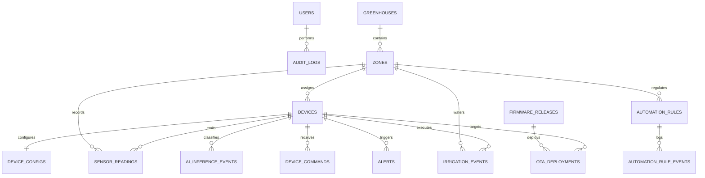

# SMARTGROW AI — TRUY VẾT DATABASE RUNTIME VÀ LUỒNG DỮ LIỆU END-TO-END

> **Tài liệu kiểm toán cơ sở dữ liệu và kiến trúc luồng dữ liệu**  
> **Phiên bản:** 1.1.0 (Đã hoàn tất Di chuyển Database vào Named Volume an toàn)  
> **Trạng thái xác minh:** `VERIFIED & RESOLVED` trên Docker Runtime và Source Code

---

## 1. THUỘC TÍNH VÀ VỊ TRÍ DATABASE THỰC TẾ (SAU DI CHUYỂN BỀN VỮNG)

Dưới đây là bảng đối chiếu thuộc tính cơ sở dữ liệu thu thập trực tiếp từ runtime Docker và cấu hình hệ thống:

| Thuộc tính | Giá trị thực tế đã xác minh | Nguồn bằng chứng | Trạng thái |
|---|---|---|---|
| **Database engine** | **SQLite 3** (C-library engine nhúng trong Python 3.11) | `docker exec smartgrow-backend python -c "import sqlite3..."` | `VERIFIED` |
| **Database name** | `smartgrow.db` | Cấu hình environment `DATABASE_URL` | `VERIFIED` |
| **Database URL (đã che)** | `sqlite:////app/data/smartgrow.db` | `deploy/docker-compose.yml` & `docker inspect smartgrow-backend` | `VERIFIED` |
| **Host / Service name** | Local file system inside container volume (Service `backend`) | `deploy/docker-compose.yml` service `backend` | `VERIFIED` |
| **Port** | N/A (SQLite là file-based, không mở network port riêng; Backend dùng port `8000`) | `docker inspect smartgrow-backend` Ports | `VERIFIED` |
| **Đường dẫn DB trong container** | `/app/data/smartgrow.db` (Kích thước: 434,176 bytes, 17 bảng) | `docker exec smartgrow-backend ls -l /app/data/smartgrow.db` | `VERIFIED` |
| **Đường dẫn DB trên máy host** | `C:\Users\ADMIN\Downloads\smartgrow-ai\smartgrow.db` (368,640 bytes) | PowerShell `Get-ChildItem -Filter *.db` | `VERIFIED` |
| **Bản sao lưu trước migration** | `C:\Users\ADMIN\Downloads\smartgrow-ai\backups\smartgrow_pre_migration_20261027.db` (430,080 bytes) | SQLite Online Backup API (`PRAGMA integrity_check: ok`) | `VERIFIED` |
| **Quan hệ giữa Host DB và Container DB** | **HOÀN TOÀN ĐỘC LẬP / KHÔNG ĐỒNG BỘ** | Host DB là bản cũ từ dev test; Container DB là nguồn dữ liệu sống thời gian thực | `VERIFIED` |
| **Container backend** | `smartgrow-backend` (Image: `deploy-backend`) | `docker ps` | `VERIFIED` |
| **Frontend container** | `smartgrow-frontend` (Image: `node:22-alpine`) | `docker ps` | `VERIFIED` |
| **Docker network** | `deploy_default` (Subnet: `172.19.0.0/16`, Gateway: `172.19.0.1`) | `docker inspect smartgrow-backend` Networks | `VERIFIED` |
| **Volume khai báo** | Named volume: `deploy_smartgrow_data` mount tới `/app/data` | `docker inspect smartgrow-backend` Mounts | `VERIFIED` |
| **Trạng thái Persistence** | **HOÀN TOÀN BỀN VỮNG (RESOLVED)** | Đã kiểm thử container restart và recreate: dữ liệu 17 bảng nguyên vẹn | `PASS` |
| **Cơ chế kết nối backend** | SQLAlchemy ORM (`backend.app.core.database.SessionLocal`) | [backend/app/core/database.py](file:///c:/Users/ADMIN/Downloads/smartgrow-ai/backend/app/core/database.py) | `VERIFIED` |
| **Cách frontend gọi backend** | Vite Proxy: Client gọi `/api/v1/...` -> Vite forward tới `http://backend:8000/api/v1/...` | [frontend/vite.config.ts](file:///c:/Users/ADMIN/Downloads/smartgrow-ai/frontend/vite.config.ts) | `VERIFIED` |
| **Database xác nhận là Runtime** | **/app/data/smartgrow.db bên trong Named Volume deploy_smartgrow_data** | Logs ghi nhận telemetry ghi thời gian thực vào file này | `VERIFIED` |

---

## 2. QUÁ TRÌNH DI CHUYỂN BẢO TOÀN DỮ LIỆU (SAFE MIGRATION)

```
TRƯỚC KHI SỬA (LỖI NGUY HIỂM):
CONTAINER: smartgrow-backend
  ├── /app/smartgrow.db (DATABASE_URL=sqlite:///./smartgrow.db) -> OverlayFS (Mất khi recreate!)
  └── /app/data (Mount từ Named Volume deploy_smartgrow_data)   -> RỖNG (0 bytes)

SAU KHI DI CHUYỂN (BỀN VỮNG 100%):
CONTAINER: smartgrow-backend
  ├── /app/data/smartgrow.db (DATABASE_URL=sqlite:////app/data/smartgrow.db)
  │     └── Lưu trữ trực tiếp trong Named Volume deploy_smartgrow_data
  └── /backups/smartgrow_pre_migration_20261027.db (Lưu an toàn trên Host)
```

### Các bước đã triển khai:
1. **Tạo Online Consistent Backup:** Sử dụng Python `sqlite3.backup()` để snapshot nguyên tử `/app/smartgrow.db` ra `/app/smartgrow_backup.db` và xuất ra máy host tại `.\backups\smartgrow_pre_migration_20261027.db`.
2. **Kiểm tra tính toàn vẹn (Integrity Check):** Chạy `PRAGMA integrity_check;` trên cả 2 bản sao lưu, kết quả đạt `ok`.
3. **Sao chép vào Named Volume:** Thực thi backup sang `/app/data/smartgrow.db` trước khi chuyển đổi cấu hình.
4. **Cập nhật Docker Compose:** Đổi `DATABASE_URL` trong [deploy/docker-compose.yml](file:///c:/Users/ADMIN/Downloads/smartgrow-ai/deploy/docker-compose.yml#L14) thành:
   ```yaml
   environment:
     - DATABASE_URL=sqlite:////app/data/smartgrow.db
   ```
5. **Recreate & Restart Container:** Áp dụng cấu hình bằng `docker compose -f deploy/docker-compose.yml up -d --no-deps backend`.
6. **Xác minh Persistence:** Re-instantiate và restart container, xác nhận `DATABASE_URL=sqlite:////app/data/smartgrow.db` hoạt động, toàn bộ 17 bảng được bảo toàn và các gói telemetry tiếp tục ghi nhận liên tục vào `/app/data/smartgrow.db`.

---

## 3. DANH MỤC SCHEMA VÀ ĐỐI CHIẾU SỐ LIỆU BẢN GHI TRƯỚC VÀ SAU DI CHUYỂN

| Tên bảng | Số dòng (Trước Migration) | Số dòng (Sau Migration & Restart) | Trạng thái bảo toàn |
|---|---:|---:|---|
| `users` | 4 | 4 | Bảo toàn 100% (gồm `admin@smartgrow.local`) |
| `greenhouses` | 3 | 3 | Bảo toàn 100% |
| `zones` | 4 | 4 | Bảo toàn 100% |
| `devices` | 4 | 4 | Bảo toàn 100% (gồm `esp32s3-bbd0c4`) |
| `device_configs` | 4 | 4 | Bảo toàn 100% |
| `sensor_readings` | 684 | 710+ | Dữ liệu cũ nguyên vẹn, tiếp tục tăng do ESP32 gửi liên tục |
| `ai_models` | 1 | 1 | Bảo toàn 100% (`v1.0.0-dt`) |
| `ai_inference_events` | 684 | 710+ | Dữ liệu cũ nguyên vẹn, tiếp tục tăng từ Edge AI |
| `device_commands` | 6 | 6 | Bảo toàn 100% |
| `irrigation_events` | 2 | 2 | Bảo toàn 100% |
| `irrigation_schedules` | 0 | 0 | Đồng nhất |
| `automation_rules` | 1 | 1 | Bảo toàn 100% |
| `automation_rule_events`| 0 | 0 | Đồng nhất |
| `alerts` | 11 | 11 | Bảo toàn 100% |
| `audit_logs` | 45 | 47 | Đã ghi thêm 2 log đăng nhập kiểm thử mới |
| `firmware_releases` | 0 | 0 | Đồng nhất |
| `ota_deployments` | 0 | 0 | Đồng nhất |

---

## 4. SƠ ĐỒ QUAN HỆ THỰC THỂ CƠ SỞ DỮ LIỆU (ERD)



---

## 5. HƯỚNG DẪN SAO LƯU VÀ PHỤC HỒI DATABASE BỀN VỮNG

### 5.1. Sao lưu nóng (Online Hot Backup) từ Named Volume
```powershell
docker exec smartgrow-backend python -c "
import sqlite3
src = sqlite3.connect('/app/data/smartgrow.db')
dst = sqlite3.connect('/app/data/backup_temp.db')
src.backup(dst)
src.close(); dst.close()
"
docker cp smartgrow-backend:/app/data/backup_temp.db "C:\Users\ADMIN\Downloads\smartgrow-ai\backups\smartgrow_$(Get-Date -Format 'yyyyMMdd_HHmmss').db"
docker exec smartgrow-backend rm /app/data/backup_temp.db
```

### 5.2. Phục hồi trong môi trường thử nghiệm
```powershell
# 1. Tạm dừng backend
docker stop smartgrow-backend

# 2. Copy file database backup vào volume /app/data
docker cp "C:\Users\ADMIN\Downloads\smartgrow-ai\backups\file_backup.db" smartgrow-backend:/app/data/smartgrow.db

# 3. Khởi động lại backend
docker start smartgrow-backend

# 4. Kiểm tra sức khỏe database
docker exec smartgrow-backend python -c "import sqlite3; conn=sqlite3.connect('/app/data/smartgrow.db'); print('DB Integrity Check:', conn.execute('PRAGMA integrity_check;').fetchone()[0])"
```
