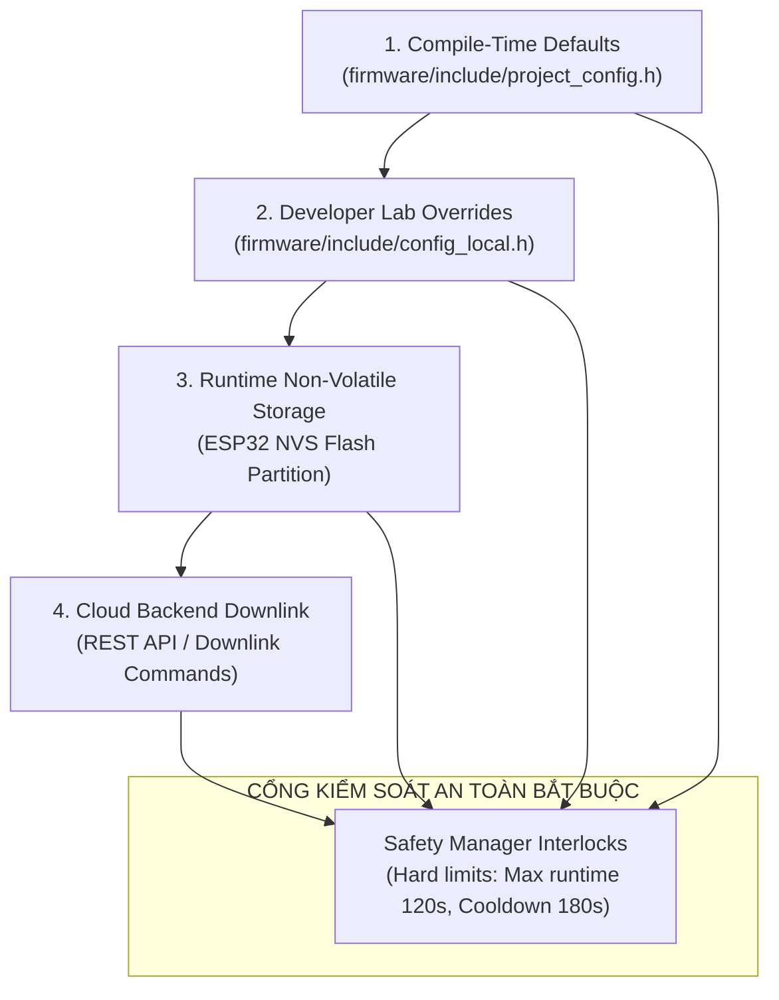

# SmartGrow AI — Firmware Configuration Architecture & Maintenance Guide

**Document Version:** 2.0.0  
**Target Hardware:** ESP32-S3 DevKitC-1 N16R8  
**Master Focal Configuration File:** [`firmware/include/project_config.h`](file:///c:/Users/ADMIN/Downloads/smartgrow-ai/firmware/include/project_config.h)  
**Runtime Manager Source:** [`firmware/src/firmware_config.c`](file:///c:/Users/ADMIN/Downloads/smartgrow-ai/firmware/src/firmware_config.c) / [`firmware/include/firmware_config.h`](file:///c:/Users/ADMIN/Downloads/smartgrow-ai/firmware/include/firmware_config.h)

---

## 1. Giới thiệu và Nguyên tắc Quản lý Cấu hình Tập trung

Trước đây, cấu hình firmware của các hệ thống IoT nhúng thường bị phân tán ở nhiều header (`board_config.h`, `config_defaults.h`, macro riêng trong từng driver và các số hằng số ma thuật / magic numbers rải rác trong source code). Điều này gây ra nguy cơ xung đột cấu hình, sai lệch cực tính rơ-le hoặc quên cập nhật ngưỡng an toàn.

Trong dự án **SmartGrow AI**, toàn bộ cấu hình firmware đã được chuẩn hóa theo mô hình **Một Đầu Mối Duy Nhất (Single Source of Truth)**:
- Mọi thông số compile-time, chân GPIO, giới hạn an toàn, chu kỳ lấy mẫu, thông số TinyML và ngưỡng hiệu chuẩn đều được khai báo tập trung tại:  
  [`firmware/include/project_config.h`](file:///c:/Users/ADMIN/Downloads/smartgrow-ai/firmware/include/project_config.h)
- Các file cũ như [`firmware/include/board_config.h`](file:///c:/Users/ADMIN/Downloads/smartgrow-ai/firmware/include/board_config.h) và [`firmware/include/config_defaults.h`](file:///c:/Users/ADMIN/Downloads/smartgrow-ai/firmware/include/config_defaults.h) đóng vai trò là tầng tương thích ngược (Backward-Compatibility Layer), ánh xạ trực tiếp về các symbol của `project_config.h`.

---

## 2. Phân loại 4 Tầng Cấu hình & Thứ tự Ưu tiên (Precedence Hierarchy)

Hệ thống cấu hình SmartGrow AI được phân định rõ ràng thành 4 tầng riêng biệt để đảm bảo tính an toàn, bảo mật thông tin bí mật (secrets) và khả năng cập nhật linh hoạt từ xa:



### Thứ tự ưu tiên áp dụng cấu hình:
$$\text{Compile-Time Default} \longrightarrow \text{config\_local.h} \longrightarrow \text{NVS Persistence} \longrightarrow \text{Backend Cloud Update}$$

1. **Tầng 1: Compile-Time Defaults (`project_config.h`)**
   - Giá trị xuất xưởng mặc định được nhúng trực tiếp vào mã máy khi biên dịch.
   - Luôn đảm bảo hệ thống có thể khởi động an toàn ngay cả khi NVS trống hoặc bị hỏng phân vùng dữ liệu.
2. **Tầng 2: Developer Local Overrides (`config_local.h`)**
   - File nằm cục bộ trên máy lập trình viên, được liệt kê trong `.gitignore` để **tuyệt đối không bị commit lên kho Git**.
   - Dùng để ghi đè Wi-Fi SSID, mật khẩu lab cá nhân, địa chỉ IP máy chủ backend mà không làm ảnh hưởng đến cấu hình chung của nhóm.
3. **Tầng 3: Runtime Non-Volatile Storage (NVS Persistence)**
   - Lưu trữ các thông số có thể điều chỉnh trong lúc thiết bị hoạt động (chế độ điều khiển `ControlMode`, điểm hiệu chuẩn cảm biến đất, ngưỡng tưới cục bộ).
   - Được bảo vệ bằng cơ chế kiểm tra tính toàn vẹn (Validation check). Nếu dữ liệu NVS bị lỗi, firmware sẽ tự động phục hồi về chế độ an toàn mặc định `CONTROL_MODE_SAFE`.
4. **Tầng 4: Backend Cloud Downlink (`CONFIG_UPDATE`)**
   - Các lệnh cập nhật từ Cloud gửi xuống qua giao thức HTTP REST Downlink.
   - Mọi giá trị cập nhật đều phải vượt qua bộ kiểm tra tính hợp lệ ([`firmware_config_validate()`](file:///c:/Users/ADMIN/Downloads/smartgrow-ai/firmware/src/firmware_config.c#L124)) trước khi được ghi vào RAM và NVS.
   - **Giới hạn bất biến (Safety Invariant):** Không có bất kỳ lệnh Cloud nào có thể ghi đè làm nới lỏng giới hạn an toàn tối đa của rơ-le (120 giây) hoặc bỏ qua thời gian cooldown (180 giây).

---

## 3. Bảng Tra cứu Toàn bộ Tham số Firmware

| Tham số | Giá trị mặc định | Đơn vị | Symbol tại `project_config.h` | Module tiêu thụ (Consumer) | Điều kiện kiểm tra (Validation) | Kiểm thử liên quan |
|---|---|---|---|---|---|---|
| **Board Name** | `"ESP32-S3-N16R8"` | String | `PROJECT_BOARD_NAME` | `main.c`, `telemetry_client.c` | Chuỗi ký tự không rỗng | `test_firmware_native.c` |
| **Firmware Version** | `"1.0.0"` | SemVer | `PROJECT_FIRMWARE_VERSION` | `network_client.c`, `ota_manager.c` | Chuỗi định dạng X.Y.Z | `test_firmware_backend_integration.py` |
| **Schema Version** | `"1.0.0"` | SemVer | `PROJECT_SCHEMA_VERSION` | `telemetry_client.c` | Khớp DTO Backend | `test_backend_api.py` |
| **Soil ADC Pin** | `1` | GPIO Pin | `PROJECT_PIN_SOIL_ADC` | `sensor_manager.c` | Chân ADC1, không trùng chân khác | Static Assert / Native Test |
| **LDR ADC Pin** | `2` | GPIO Pin | `PROJECT_PIN_LDR_ADC` | `sensor_manager.c` | Chân ADC1, không trùng chân khác | Static Assert / Native Test |
| **DHT11 Data Pin** | `4` | GPIO Pin | `PROJECT_PIN_DHT11` | `dht11.c`, `sensor_manager.c` | Chân Digital I/O, không trùng | Static Assert / Native Test |
| **I2C SDA Pin** | `8` | GPIO Pin | `PROJECT_PIN_I2C_SDA` | `firmware_config.c` | Chân Digital I/O, không trùng | Static Assert / Native Test |
| **I2C SCL Pin** | `9` | GPIO Pin | `PROJECT_PIN_I2C_SCL` | `firmware_config.c` | Chân Digital I/O, không trùng | Static Assert / Native Test |
| **Pump Relay Pin** | `10` | GPIO Pin | `PROJECT_PIN_RELAY_PUMP` | `actuator_manager.c` | **CẤM GPIO 15-18 & 33-37** | Static Assert & Pre-flight |
| **Servo Vent Pin** | `11` | GPIO Pin | `PROJECT_PIN_SERVO_VENT` | `actuator_manager.c` | Chân Digital PWM, không trùng | Static Assert / Native Test |
| **Buzzer Pin** | `12` | GPIO Pin | `PROJECT_PIN_BUZZER` | `actuator_manager.c` | Chân Digital Out, không trùng | Static Assert / Native Test |
| **Status LED Pin** | `21` | GPIO Pin | `PROJECT_PIN_STATUS_LED` | `actuator_manager.c` | Chân Digital Out, không trùng | Static Assert / Native Test |
| **Relay Active Level** | `1` (Active-HIGH) | 0/1 | `PROJECT_RELAY_PUMP_ACTIVE_LEVEL` | `actuator_manager.c` | Chỉ nhận giá trị 0 hoặc 1 | Hardware Pre-flight Test |
| **LED Active Level** | `1` (Active-HIGH) | 0/1 | `PROJECT_STATUS_LED_ACTIVE_LEVEL` | `actuator_manager.c` | Chỉ nhận giá trị 0 hoặc 1 | Native Test |
| **Max Pump Runtime** | `120000` (120s) | ms | `PROJECT_SAFETY_MAX_PUMP_DURATION_MS` | `safety_manager.c` | $0 < t \le 300000$ ms | `test_firmware_native.c` |
| **Min Pump Cooldown** | `180000` (180s) | ms | `PROJECT_SAFETY_MIN_PUMP_COOLDOWN_MS` | `safety_manager.c` | $t > 0$ ms | `test_firmware_native.c` |
| **Offline Failsafe** | `300000` (300s) | ms | `PROJECT_SAFETY_OFFLINE_FAILSAFE_MS` | `safety_manager.c` | $t \ge 60000$ ms | `test_firmware_native.c` |
| **Safety Min Temp** | `0.0` | °C | `PROJECT_SAFETY_MIN_SAFE_TEMP_C` | `safety_manager.c` | Min < Max | `test_firmware_native.c` |
| **Safety Max Temp** | `50.0` | °C | `PROJECT_SAFETY_MAX_SAFE_TEMP_C` | `safety_manager.c` | Max > Min | `test_firmware_native.c` |
| **DHT11 Interval** | `2000` | ms | `PROJECT_DHT11_SAMPLE_INTERVAL_MS` | `dht11.c`, `main.c` | $t \ge 1000$ ms | `test_firmware_native.c` |
| **DHT11 Timeout** | `100` | ms | `PROJECT_DHT11_READ_TIMEOUT_MS` | `dht11.c` | $10 \le t \le 500$ ms | `test_firmware_native.c` |
| **DHT11 Temp Min** | `0.0` | °C | `PROJECT_DHT11_TEMP_MIN_C` | `dht11.c`, `sensor_manager.c` | Đạt chuẩn danh định DHT11 | `test_firmware_native.c` |
| **DHT11 Temp Max** | `50.0` | °C | `PROJECT_DHT11_TEMP_MAX_C` | `dht11.c`, `sensor_manager.c` | Đạt chuẩn danh định DHT11 | `test_firmware_native.c` |
| **DHT11 Hum Min** | `20.0` | % RH | `PROJECT_DHT11_HUMIDITY_MIN_PCT` | `dht11.c`, `sensor_manager.c` | $0 \le h < 100$ | `test_firmware_native.c` |
| **DHT11 Hum Max** | `90.0` | % RH | `PROJECT_DHT11_HUMIDITY_MAX_PCT` | `dht11.c`, `sensor_manager.c` | $0 < h \le 100$ | `test_firmware_native.c` |
| **DHT11 Fault Limit**| `3` | Lần | `PROJECT_DHT11_MAX_CONSECUTIVE_ERRORS`| `dht11.c` | $1 \le n \le 10$ | `test_firmware_native.c` |
| **Soil ADC Dry Raw** | `3200` | ADC counts | `PROJECT_SOIL_ADC_DRY_RAW` | `sensor_calibration.c` | Dry > Wet + 200 counts | `test_firmware_native.c` |
| **Soil ADC Wet Raw** | `1200` | ADC counts | `PROJECT_SOIL_ADC_WET_RAW` | `sensor_calibration.c` | Wet < Dry - 200 counts | `test_firmware_native.c` |
| **ADC Vref** | `3300.0` | mV | `PROJECT_ADC_VREF_MV` | `sensor_calibration.c` | $2500 \le V \le 3600$ mV | `test_firmware_native.c` |
| **Soil Plausible Min**| `150` | ADC counts | `PROJECT_SOIL_RAW_MIN_PLAUSIBLE` | `sensor_calibration.c` | Ngưỡng báo chập mass | `test_firmware_native.c` |
| **Soil Plausible Max**| `3850` | ADC counts | `PROJECT_SOIL_RAW_MAX_PLAUSIBLE` | `sensor_calibration.c` | Ngưỡng báo tuột dây | `test_firmware_native.c` |
| **Control Mode** | `0` (AUTO) | Enum | `PROJECT_CONTROL_MODE_DEFAULT` | `main.c`, `firmware_config.c` | Phạm vi 0 đến 4 | `test_firmware_native.c` |
| **Local Rule Enabled**| `true` | bool | `PROJECT_LOCAL_RULE_ENABLED` | `main.c` | true / false | `test_firmware_native.c` |
| **Local Rule Soil %** | `30.0` | % | `PROJECT_LOCAL_RULE_SOIL_THRESHOLD_PCT`| `main.c` | $5.0 \le p \le 60.0$ | `test_firmware_native.c` |
| **Local Rule Pump Dur**| `30` | s | `PROJECT_LOCAL_RULE_PUMP_DURATION_S` | `main.c` | $5 \le s \le 120$ | `test_firmware_native.c` |
| **Local Rule Cooldown**| `180` | s | `PROJECT_LOCAL_RULE_COOLDOWN_S` | `main.c` | $s \ge 60$ | `test_firmware_native.c` |
| **AI Model Version** | `"v1.0.0-dt"` | String | `PROJECT_AI_MODEL_VERSION` | `edge_ai.c`, `network_client.c` | Khớp version model | `test_ai_parity.c` |
| **AI Confidence Thresh**| `0.50` | Ratio | `PROJECT_AI_CONFIDENCE_THRESHOLD` | `edge_ai.c` | $0.0 \le c \le 1.0$ | `test_ai_parity.c` |
| **AI Inference Period**| `2000` | ms | `PROJECT_AI_INFERENCE_INTERVAL_MS` | `main.c` | $t \ge 1000$ ms | `test_firmware_native.c` |
| **Wi-Fi SSID** | `"SmartGrow_Lab"`| String | `PROJECT_WIFI_SSID_DEFAULT` | `wifi_manager.c` | Độ dài 1 - 32 ký tự | `test_firmware_native.c` |
| **Wi-Fi Initial Backoff**| `1000` | ms | `PROJECT_WIFI_INITIAL_BACKOFF_MS` | `wifi_manager.c` | $t \ge 500$ ms | `test_firmware_native.c` |
| **Wi-Fi Max Backoff** | `30000` | ms | `PROJECT_WIFI_MAX_BACKOFF_MS` | `wifi_manager.c` | $t \le 300000$ ms | `test_firmware_native.c` |
| **Backend Host** | `"192.168.1.2"`| IPv4/Host | `PROJECT_BACKEND_HOST_DEFAULT` | `network_client.c` | Host không rỗng | `test_firmware_native.c` |
| **Backend Port** | `8000` | Port | `PROJECT_BACKEND_PORT_DEFAULT` | `network_client.c` | $1 \le \text{port} \le 65535$ | `test_firmware_native.c` |
| **Telemetry Interval** | `5000` | ms | `PROJECT_TELEMETRY_INTERVAL_MS` | `main.c` | $1000 \le t \le 60000$ ms | `test_firmware_native.c` |
| **Command Poll Period**| `3000` | ms | `PROJECT_COMMAND_POLL_INTERVAL_MS` | `main.c` | $1000 \le t \le 30000$ ms | `test_firmware_native.c` |
| **HTTP Timeout** | `5000` | ms | `PROJECT_HTTP_TIMEOUT_MS` | `network_client.c` | $500 \le t \le 60000$ ms | `test_firmware_native.c` |
| **Idempotency History**| `8` | Slots | `PROJECT_IDEMPOTENCY_HISTORY_SIZE` | `command_manager.c` | $4 \le n \le 32$ | `test_firmware_native.c` |

---

## 4. Hướng dẫn Thay đổi Thông số Kỹ thuật Thực tế

### 4.1. Thay đổi thông số Compile-Time toàn dự án
Nếu bạn muốn thay đổi thông số mặc định cho toàn bộ firmware xuất xưởng:
1. Mở file [`firmware/include/project_config.h`](file:///c:/Users/ADMIN/Downloads/smartgrow-ai/firmware/include/project_config.h).
2. Tìm macro tương ứng (ví dụ: muốn đổi chu kỳ gửi Telemetry thành 10 giây, tìm `PROJECT_TELEMETRY_INTERVAL_MS`).
3. Chỉnh sửa giá trị:
   ```c
   #define PROJECT_TELEMETRY_INTERVAL_MS 10000 /* Đổi từ 5000ms sang 10000ms */
   ```
4. Chạy kiểm thử kiểm tra tính hợp lệ:
   ```powershell
   gcc -Wall -Wextra -I firmware/include firmware/src/*.c firmware/test/test_firmware_native.c -o firmware/test/test_firmware_native.exe
   .\firmware\test\test_firmware_native.exe
   ```

### 4.2. Cấu hình Cục bộ cho Lập trình viên (Developer Lab Override)
Để thay đổi Wi-Fi hoặc IP mà không sửa `project_config.h` và không bị Git track:
1. Tạo file `firmware/include/config_local.h` (dựa trên mẫu `config_local.h.example`):
   ```c
   #ifndef CONFIG_LOCAL_H
   #define CONFIG_LOCAL_H

   #define PROJECT_WIFI_SSID_DEFAULT     "WiFi_Nha_Kinh_02"
   #define PROJECT_WIFI_PASSWORD_DEFAULT "MatKhauBaoMat123"
   #define PROJECT_BACKEND_HOST_DEFAULT  "192.168.1.150"
   #define PROJECT_BACKEND_PORT_DEFAULT  8000

   #endif
   ```
2. `project_config.h` tự động nạp `config_local.h` thông qua chỉ thị `#if __has_include("config_local.h")`.

### 4.3. Hiệu chuẩn Cảm biến Độ ẩm đất Thực tế (Calibration Walkthrough)
1. Cắm cảm biến vào mạch, để ngoài không khí khô ráo, đọc giá trị thô trên Serial Monitor: giả sử đo được `3150`.
2. Nhúng phần lưỡi cảm biến vào cốc nước sạch (ngập 70% lưỡi đo), đọc giá trị thô: giả sử đo được `1250`.
3. Cập nhật vào `project_config.h`:
   ```c
   #define PROJECT_SOIL_ADC_DRY_RAW 3150
   #define PROJECT_SOIL_ADC_WET_RAW 1250
   ```
4. Hoặc gửi lệnh cập nhật động từ Backend mà không cần nạp lại firmware:
   ```bash
   curl -X PUT http://192.168.1.2:8000/api/v1/devices/esp32s3-default/config \
        -H "Content-Type: application/json" \
        -d '{"soil_dry_adc": 3150, "soil_wet_adc": 1250}'
   ```

### 4.4. Thay đổi Chế độ Điều khiển (Control Mode)
Firmware hỗ trợ 5 chế độ hoạt động:
- `CONTROL_MODE_AUTO (0)`: Edge AI đưa ra khuyến nghị; Safety Gate giám sát và cấp phép.
- `CONTROL_MODE_MANUAL (1)`: Chỉ chấp hành lệnh thủ công từ người vận hành; chặn các quyết định tự động.
- `CONTROL_MODE_RULE (2)`: Bỏ qua Edge AI, hoạt động theo ngưỡng độ ẩm đất cố định (`PROJECT_LOCAL_RULE_SOIL_THRESHOLD_PCT`).
- `CONTROL_MODE_HYBRID (3)`: Ưu tiên Edge AI; nếu Edge AI không tưới mà độ ẩm đất rớt xuống dưới ngưỡng nguy hiểm, luật cục bộ tự động kích hoạt tưới bù.
- `CONTROL_MODE_SAFE (4)`: Chế độ khóa an toàn; ngắt ngay lập tức máy bơm và chặn mọi yêu cầu bật bơm.

---

## 5. Những Giá trị Tuyệt đối CẤM Thay đổi Tùy tiện

> [!WARNING]
> **Ranh giới an toàn phần cứng (Hardware Safety Thresholds):**
> 1. **Thời gian chạy bơm tối đa (`PROJECT_SAFETY_MAX_PUMP_DURATION_MS = 120000`):** Không được vượt quá 300,000ms (5 phút). Đặt quá lớn sẽ dẫn đến cháy máy bơm mini (cháy cuộn dây động cơ) hoặc làm ngập úng rễ cây trồng.
> 2. **Thời gian làm nguội bơm (`PROJECT_SAFETY_MIN_PUMP_COOLDOWN_MS = 180000`):** Tối thiểu phải là 60,000ms (1 phút). Khoảng nghỉ này giúp nước ngấm đều vào đất trước khi cảm biến đo lại, tránh hiện tượng bơm liên tục gây dư nước.
> 3. **Chân Rơ-le (`PROJECT_PIN_RELAY_PUMP = 10`):** Tuyệt đối không trỏ về các chân `GPIO 15..18` hoặc `GPIO 33..37` vì đó là bus truyền dữ liệu Octal PSRAM / Flash của vi điều khiển ESP32-S3.

---

## 6. Quy trình Build và Kiểm thử Sau khi Đổi Cấu hình

Sau bất kỳ chỉnh sửa nào trong cấu hình, kỹ sư phải chạy chuỗi lệnh kiểm thử tĩnh và kiểm thử đơn vị sau:

```powershell
# 1. Chạy bộ kiểm thử Native Firmware (287 test cases)
gcc -Wall -Wextra -I firmware/include firmware/src/sensor_calibration.c firmware/src/sensor_manager.c firmware/src/safety_manager.c firmware/src/actuator_manager.c firmware/src/command_manager.c firmware/src/telemetry_client.c firmware/src/wifi_manager.c firmware/src/network_client.c firmware/src/edge_ai_model.c firmware/src/edge_ai.c firmware/src/ota_manager.c firmware/src/firmware_config.c firmware/src/dht11.c firmware/test/test_firmware_native.c -o firmware/test/test_firmware_native.exe
.\firmware\test\test_firmware_native.exe

# 2. Chạy bộ kiểm thử Parity giữa Python và C (500 test samples)
gcc -Wall -Wextra -I firmware/include firmware/src/edge_ai_model.c firmware/test/test_ai_parity.c -o firmware/test/test_ai_parity.exe
.\firmware\test\test_ai_parity.exe

# 3. Chạy kiểm thử HIL Runner ở chế độ giả lập
$env:PYTHONPATH="."
backend\.venv\Scripts\python tests/hil/hil_runner.py --sim-only

# 4. Chạy kiểm thử Backend và Hợp đồng Tích hợp (24 test cases)
backend\.venv\Scripts\pytest backend/tests tests/integration -q
```
