# SmartGrow AI — Hardware Wiring, GPIO Pinout & Physical Installation Guide

**Document Version:** 2.0.0  
**Target Hardware:** ESP32-S3 DevKitC-1 N16R8 (Xtensa dual-core 32-bit LX7, 16MB Quad-SPI Flash, 8MB Octal-SPI PSRAM)  
**Primary Configuration Source:** [`firmware/include/project_config.h`](file:///c:/Users/ADMIN/Downloads/smartgrow-ai/firmware/include/project_config.h)  
**Audit Status:** Fully Verified against Source Code & ESP32-S3 Technical Reference Manual

---

## 1. Mục đích và Phạm vi tài liệu

Tài liệu này là **tài liệu tham chiếu chính thức duy nhất** về phần cứng, sơ đồ chân GPIO, thông số điện áp, cực tính tín hiệu và hướng dẫn lắp đặt cho toàn bộ hệ thống SmartGrow AI.

Tất cả các thông số trong tài liệu này được đối chiếu trực tiếp và kiểm chứng từ:
1. File cấu hình trung tâm [`firmware/include/project_config.h`](file:///c:/Users/ADMIN/Downloads/smartgrow-ai/firmware/include/project_config.h).
2. Code khởi tạo phần cứng [`firmware/src/actuator_manager.c`](file:///c:/Users/ADMIN/Downloads/smartgrow-ai/firmware/src/actuator_manager.c), [`firmware/src/sensor_manager.c`](file:///c:/Users/ADMIN/Downloads/smartgrow-ai/firmware/src/sensor_manager.c), [`firmware/src/dht11.c`](file:///c:/Users/ADMIN/Downloads/smartgrow-ai/firmware/src/dht11.c).
3. Espressif ESP32-S3 Series Datasheet & ESP32-S3 Technical Reference Manual (TRM).

> [!CAUTION]
> **Quy định an toàn tuyệt đối:**
> - Không cấp điện cho máy bơm trực tiếp từ chân 3.3V hoặc 5V của ESP32.
> - Bắt buộc dùng nguồn ngoài riêng (External 5V/12V DC Supply) cho tải động cơ (bơm, servo).
> - Nối chung đất (Common GND) giữa nguồn ngoài và nguồn ESP32.
> - Trước khi đóng điện lần đầu vào tải thật, phải hoàn thành kiểm tra Pre-flight bằng đồng hồ vạn năng (DMM) ở chế độ đo điện áp DC.

---

## 2. Kiểm kê Linh kiện Phần cứng Thực tế

Bảng dưới đây liệt kê tất cả các linh kiện thực sự được hỗ trợ và điều khiển trong mã nguồn firmware:

| Linh kiện | Model / Phiên bản | Điện áp cấp (VCC) | Logic Level | Giao tiếp | Số lượng | Nguồn bằng chứng | Trạng thái |
|---|---|---|---|---|---|---|---|
| **MCU Development Board** | ESP32-S3 DevKitC-1 N16R8 | 5V qua USB Type-C hoặc chân 5V | 3.3V CMOS | USB / Wi-Fi 802.11 b/g/n | 1 | [`platformio.ini:6`](file:///c:/Users/ADMIN/Downloads/smartgrow-ai/firmware/platformio.ini#L6), [`project_config.h:46`](file:///c:/Users/ADMIN/Downloads/smartgrow-ai/firmware/include/project_config.h#L46) | **PASS** |
| **Cảm biến độ ẩm đất** | Capacitive Soil Moisture Sensor v1.2 / v2.0 | 3.3V (Khuyến nghị) hoặc 5V | 0.0V - 3.0V Analog | ADC1_CH0 (GPIO1) | 1 | [`sensor_manager.c:47`](file:///c:/Users/ADMIN/Downloads/smartgrow-ai/firmware/src/sensor_manager.c#L47), [`project_config.h:65`](file:///c:/Users/ADMIN/Downloads/smartgrow-ai/firmware/include/project_config.h#L65) | **PASS** |
| **Cảm biến nhiệt độ & độ ẩm** | DHT11 Single-Wire Digital Sensor | 3.3V hoặc 5V (Khuyến nghị 3.3V) | 3.3V CMOS Open-Drain | Single-Wire Bus (GPIO4) | 1 | [`dht11.c:58-63`](file:///c:/Users/ADMIN/Downloads/smartgrow-ai/firmware/src/dht11.c#L58-L63), [`project_config.h:75`](file:///c:/Users/ADMIN/Downloads/smartgrow-ai/firmware/include/project_config.h#L75) | **PASS** |
| **Cảm biến ánh sáng** | Photoresistor (LDR) Module với cầu phân áp | 3.3V | 0.0V - 3.3V Analog | ADC1_CH1 (GPIO2) | 1 | [`sensor_manager.c:48`](file:///c:/Users/ADMIN/Downloads/smartgrow-ai/firmware/src/sensor_manager.c#L48), [`project_config.h:69`](file:///c:/Users/ADMIN/Downloads/smartgrow-ai/firmware/include/project_config.h#L69) | **PASS** |
| **Rơ-le điều khiển máy bơm** | Songle SRD-05VDC-SL-C (1-Channel Optocoupled Relay) | 5V riêng (JD-VCC/VCC) | 3.3V Logic Trigger | Digital Output (GPIO10) | 1 | [`actuator_manager.c:28-30`](file:///c:/Users/ADMIN/Downloads/smartgrow-ai/firmware/src/actuator_manager.c#L28-L30), [`project_config.h:89`](file:///c:/Users/ADMIN/Downloads/smartgrow-ai/firmware/include/project_config.h#L89) | **PASS** |
| **Máy bơm nước tưới** | Máy bơm chìm mini DC (3V-6V hoặc 12V DC) | Nguồn ngoài độc lập | Không nối trực tiếp MCU | Tiếp điểm Relay (COM / NO) | 1 | [`safety_manager.c:226`](file:///c:/Users/ADMIN/Downloads/smartgrow-ai/firmware/src/safety_manager.c#L226) | **PASS** |
| **Động cơ Servo đóng/mở mái** | Micro Servo SG90 / MG90S | 5V riêng (Không dùng chân 3.3V) | 3.3V PWM (50Hz) | PWM Digital (GPIO11) | 1 | [`actuator_manager.c:60-66`](file:///c:/Users/ADMIN/Downloads/smartgrow-ai/firmware/src/actuator_manager.c#L60-L66), [`project_config.h:93`](file:///c:/Users/ADMIN/Downloads/smartgrow-ai/firmware/include/project_config.h#L93) | **PASS** |
| **Còi báo động Piezo** | Active Piezo Buzzer 5V / 3.3V | 3.3V hoặc 5V | 3.3V Digital Output | Digital Output (GPIO12) | 1 | [`actuator_manager.c:68-74`](file:///c:/Users/ADMIN/Downloads/smartgrow-ai/firmware/src/actuator_manager.c#L68-L74), [`project_config.h:97`](file:///c:/Users/ADMIN/Downloads/smartgrow-ai/firmware/include/project_config.h#L97) | **PASS** |
| **Đèn LED trạng thái** | On-board / External LED + 330Ω | 3.3V | 3.3V Digital Output | Digital Output (GPIO21) | 1 | [`actuator_manager.c:33-35`](file:///c:/Users/ADMIN/Downloads/smartgrow-ai/firmware/src/actuator_manager.c#L33-L35), [`project_config.h:101`](file:///c:/Users/ADMIN/Downloads/smartgrow-ai/firmware/include/project_config.h#L101) | **PASS** |
| **Màn hình phụ (Tùy chọn)** | I2C OLED SSD1306 (128x64) | 3.3V | 3.3V I2C Bus | I2C (SDA=GPIO8, SCL=GPIO9) | 1 (Dự phòng) | [`project_config.h:79-84`](file:///c:/Users/ADMIN/Downloads/smartgrow-ai/firmware/include/project_config.h#L79-L84) | **PASS** |

---

## 3. Bảng GPIO Hoàn chỉnh và Phân tích Ràng buộc Phần cứng

### 3.1. Bảng cấu hình GPIO Master

| Component | Signal | GPIO | Direction | Interface | Active Level | Safe State | Default Value | Configuration Source | Call Sites | Wiring Pin | Voltage Constraints & Electrical Notes | Verification |
|---|---|---|---|---|---|---|---|---|---|---|---|---|
| **Soil Moisture** | Analog Signal | **GPIO 1** | Input | ADC1_CH0 | N/A | High-Z | 0V | `PROJECT_PIN_SOIL_ADC` | `sensor_manager.c:47`, `sensor_manager.c:116` | AOUT | 0.0V - 3.1V Max. Không cấp >3.3V vào chân ADC. Dùng 12dB attenuation. | **PASS** |
| **Light Sensor (LDR)** | Analog Signal | **GPIO 2** | Input | ADC1_CH1 | N/A | High-Z | 0V | `PROJECT_PIN_LDR_ADC` | `sensor_manager.c:48`, `sensor_manager.c:146` | AOUT | 0.0V - 3.3V Max. Cầu phân áp 10kΩ + LDR. | **PASS** |
| **DHT11 Sensor** | Single-Wire Bus | **GPIO 4** | Bidirectional | Digital Open-Drain | N/A (Pulse) | Pull-up HIGH | HIGH (Idle) | `PROJECT_PIN_DHT11` | `dht11.c:58-63`, `dht11.c:102` | DATA / OUT | Kéo trở 4.7kΩ - 10kΩ lên 3.3V. Chu kỳ đọc tối thiểu 1000ms (dự án đặt 2000ms). | **PASS** |
| **I2C Bus SDA** | Data Bus | **GPIO 8** | Bidirectional | I2C Open-Drain | N/A | Pull-up HIGH | HIGH | `PROJECT_PIN_I2C_SDA` | `firmware_config.c:81` | SDA | Trở kéo pull-up 4.7kΩ lên 3.3V. Chân đa dụng an toàn trên ESP32-S3. | **PASS** |
| **I2C Bus SCL** | Clock Bus | **GPIO 9** | Output | I2C Open-Drain | N/A | Pull-up HIGH | HIGH | `PROJECT_PIN_I2C_SCL` | `firmware_config.c:82` | SCL | Trở kéo pull-up 4.7kΩ lên 3.3V. | **PASS** |
| **Water Pump Relay** | Control Signal | **GPIO 10** | Output | Digital Output | **Active-HIGH (1)** (Configurable) | **INACTIVE (0)** | 0 (0V) | `PROJECT_PIN_RELAY_PUMP`, `PROJECT_RELAY_PUMP_ACTIVE_LEVEL` | `actuator_manager.c:28-30`, `actuator_manager.c:54` | IN | **XEM PHẦN 3.2**: Tuyệt đối không dùng GPIO 16. Mạch nạp pre-charge `!active_level` trước khi output enable. | **PASS** |
| **Ventilation Servo** | PWM Signal | **GPIO 11** | Output | Digital PWM | Active-HIGH | LOW (0V) | 0° (0V) | `PROJECT_PIN_SERVO_VENT` | `actuator_manager.c:60-66` | PWM (Cam/Vàng) | Tín hiệu 50Hz (chu kỳ 20ms, xung 1ms - 2ms). Nguồn servo lấy từ 5V rời. | **PASS** |
| **Piezo Buzzer** | Audio Trigger | **GPIO 12** | Output | Digital Output | Active-HIGH (1) | INACTIVE (0) | 0 (0V) | `PROJECT_PIN_BUZZER` | `actuator_manager.c:38-40`, `actuator_manager.c:71` | I / + | Dòng tiêu thụ < 20mA. Nếu dùng còi thụ động, cần PWM; nếu còi chủ động, xuất mức 1. | **PASS** |
| **Status LED** | Diagnostic LED | **GPIO 21** | Output | Digital Output | Active-HIGH (1) | INACTIVE (0) | 0 (0V) | `PROJECT_PIN_STATUS_LED`, `PROJECT_STATUS_LED_ACTIVE_LEVEL` | `actuator_manager.c:33-35` | Anode (+) | LED nối tiếp trở hạn dòng 330Ω về GND. Chân đa dụng an toàn, không vướng strapping. | **PASS** |

---

### 3.2. Giải trình Chân Rơ-le: Vì sao dùng GPIO 10 và Tuyệt đối CẤM dùng GPIO 16?

Trong quá trình re-audit, nhóm kỹ sư đã kiểm tra toàn diện cấu hình phần cứng và kiến trúc chip:

1. **Kiểm tra mã nguồn:**
   - Trong toàn bộ repository, `GPIO16` xuất hiện **0 lần** trong mã nguồn thực tế.
   - Chân rơ-le được khai báo chính thức tại [`project_config.h:89`](file:///c:/Users/ADMIN/Downloads/smartgrow-ai/firmware/include/project_config.h#L89) là `GPIO 10` (`PROJECT_PIN_RELAY_PUMP 10`).

2. **Ràng buộc phần cứng ESP32-S3 N16R8 (Octal PSRAM / Flash):**
   - Bo mạch đang sử dụng là **ESP32-S3 DevKitC-1 N16R8**, tích hợp **8MB Octal SPI PSRAM** và **16MB Quad/Octal Flash**.
   - Theo ESP32-S3 Technical Reference Manual (Mục *Peripheral Pin Allocation & Octal SPI Bus*):
     - Các chân **GPIO 15, 16, 17, 18** và **GPIO 33, 34, 35, 36, 37** được kết nối trực tiếp với chip nhớ PSRAM tốc độ cao bên trong module (SPICS1, SPIWP, SPID4..D7).
     - Nếu cấu hình firmware xuất tín hiệu Digital Output hoặc gắn dây vào **GPIO 16**, bus giao tiếp Octal PSRAM sẽ bị xung đột điện áp (bus contention), dẫn đến hiện tượng **Crash chip ngay lập tức, hỏng dữ liệu bộ nhớ Heap, hoặc kernel panic khi hệ số nhân SPI được kích hoạt**.
   - Do đó, việc chọn **GPIO 10** là hoàn toàn chính xác về mặt kỹ thuật vi mạch và an toàn nhúng.
   - Trong [`firmware/include/project_config.h`](file:///c:/Users/ADMIN/Downloads/smartgrow-ai/firmware/include/project_config.h), đã bổ sung cơ chế kiểm tra lúc biên dịch (`_Static_assert`) để ngăn chặn việc cấu hình nhầm chân rơ-le vào dải GPIO 15-18 hoặc 33-37:
     ```c
     _Static_assert(PROJECT_PIN_RELAY_PUMP != 15 && PROJECT_PIN_RELAY_PUMP != 16 &&
                    PROJECT_PIN_RELAY_PUMP != 17 && PROJECT_PIN_RELAY_PUMP != 18,
                    "CRITICAL: Relay Pump cannot be on Pins 15-18 (Octal PSRAM / Flash)");
     ```

3. **Lưu ý về chân Strapping trên ESP32-S3:**
   - Các chân strapping gồm: GPIO 0, GPIO 3, GPIO 45, GPIO 46.
   - Firmware SmartGrow AI **không** sử dụng bất kỳ chân nào trong số các chân strapping trên cho tải đầu ra (actuator), tránh trường hợp rơ-le hoặc động cơ làm thay đổi mức logic khi boot gây treo chế độ nạp flash (Download Mode) hoặc sai điện áp VDD_SPI.

---

## 4. Hướng dẫn Đấu nối Chi tiết từng Linh kiện

### 4.1. Sơ đồ Khối Đấu nối Tổng thể (Mermaid Architecture)

```mermaid
graph TD
    subgraph Power_Supply ["Nguồn Điện (Power Distribution)"]
        USB["USB 5V (Nạp & Nuôi MCU)"]
        EXT_5V["Nguồn Ngoài 5V/3A DC (External PSU)"]
        GND_COMMON["Chung Mass (Common Ground Bus)"]
    end

    subgraph MCU ["ESP32-S3 DevKitC-1 N16R8"]
        ESP_5V["Chân 5V"]
        ESP_3V3["Chân 3.3V (VCC Cảm biến)"]
        ESP_GND["Chân GND"]
        
        G1["GPIO 1 (ADC1_CH0)"]
        G2["GPIO 2 (ADC1_CH1)"]
        G4["GPIO 4 (Single-Wire)"]
        G8["GPIO 8 (I2C SDA)"]
        G9["GPIO 9 (I2C SCL)"]
        G10["GPIO 10 (Digital Out)"]
        G11["GPIO 11 (PWM Out)"]
        G12["GPIO 12 (Digital Out)"]
        G21["GPIO 21 (Digital Out)"]
    end

    subgraph Sensors ["Khối Cảm biến (Sensors Block)"]
        SOIL["Cảm biến Độ ẩm đất (Capacitive)"]
        LDR["Cảm biến Ánh sáng (Photoresistor)"]
        DHT["Cảm biến Nhiệt/Ẩm (DHT11)"]
        OLED["Màn hình I2C OLED (Tùy chọn)"]
    end

    subgraph Actuators ["Khối Điều khiển Tải (Actuators Block)"]
        RELAY["Mô-đun Rơ-le 5V Cách ly quang"]
        PUMP["Máy bơm nước Mini 5V/12V"]
        SERVO["Động cơ Servo Mở mái (SG90)"]
        BUZZER["Còi báo động Piezo"]
        LED["LED Trạng thái Hệ thống"]
    end

    %% Power Wiring
    USB --> ESP_5V
    EXT_5V --> RELAY
    EXT_5V --> SERVO
    EXT_5V -.->|Nuôi tải bơm| PUMP
    GND_COMMON --- ESP_GND
    GND_COMMON --- EXT_5V

    %% Sensor Wiring
    ESP_3V3 --> SOIL
    ESP_3V3 --> LDR
    ESP_3V3 --> DHT
    ESP_3V3 --> OLED
    GND_COMMON --- SOIL
    GND_COMMON --- LDR
    GND_COMMON --- DHT
    GND_COMMON --- OLED

    SOIL -->|AOUT| G1
    LDR -->|AOUT| G2
    DHT <-->|DATA + 4.7kΩ Pullup| G4
    OLED <-->|SDA| G8
    OLED <-->|SCL| G9

    %% Actuator Wiring
    G10 -->|Tín hiệu Kích| RELAY
    RELAY -->|Tiếp điểm NO/COM| PUMP
    G11 -->|Xung PWM 50Hz| SERVO
    G12 -->|Kích Còi| BUZZER
    G21 -->|330Ω Limit| LED
    GND_COMMON --- BUZZER
    GND_COMMON --- LED
    GND_COMMON --- SERVO
```



---

### 4.2. Hướng dẫn Đấu nối Chi tiết từng Module

#### A. Cảm biến Độ ẩm đất Điện dung (Capacitive Soil Moisture Sensor v1.2 / v2.0)
- **Chân kết nối:**
  1. `VCC` -> Chân **3.3V** của ESP32.
  2. `GND` -> Chân **GND** của ESP32.
  3. `AOUT` (Analog Out) -> Chân **GPIO 1** của ESP32 (ADC1_CH0).
- **Điện áp logic:** 0.0V đến ~3.0V DC.
- **Lưu ý đặc biệt:**
  - Khuyến cáo cấp nguồn bằng chân 3.3V thay vì 5V. Nếu cấp 5V, điện áp ra khi đất khô có thể vượt quá 3.3V, gây sai số đo hoặc hỏng bộ chuyển đổi ADC của ESP32.
  - Phủ sơn bảo vệ (silicone/keo chống thấm) phần mạch điện trên đầu cảm biến, chỉ để phần bản mạch nạp cắm vào đất.

#### B. Cảm biến Nhiệt độ & Độ ẩm DHT11
- **Chân kết nối:**
  1. `VCC` -> Chân **3.3V** của ESP32.
  2. `GND` -> Chân **GND** của ESP32.
  3. `DATA` / `OUT` -> Chân **GPIO 4** của ESP32.
- **Trở kéo (Pull-up Resistor):**
  - Giao thức DHT11 là Open-Drain. Mặc dù firmware đã kích hoạt chế độ `GPIO_PULLUP_ONLY` trong internal pull-up của chip, nhưng trở nội của ESP32 khá lớn (khoảng 45kΩ). Với đường dây dài trên 15cm, **bắt buộc phải gắn thêm trở kéo ngoại 4.7kΩ hoặc 10kΩ giữa chân DATA và 3.3V** để sườn xung vuông cạnh lên đạt chuẩn thời gian giao tiếp.
- **Khoảng cách lấy mẫu:** Tối thiểu 1000ms. Firmware cấu hình mặc định là **2000ms** ([`project_config.h:118`](file:///c:/Users/ADMIN/Downloads/smartgrow-ai/firmware/include/project_config.h#L118)).

#### C. Cảm biến Ánh sáng LDR (Photoresistor Module)
- **Chân kết nối:**
  1. `VCC` -> Chân **3.3V** của ESP32.
  2. `GND` -> Chân **GND** của ESP32.
  3. `AO` (Analog Out) -> Chân **GPIO 2** của ESP32 (ADC1_CH1).
- **Nguyên lý:** Trời sáng điện trở LDR giảm -> Điện áp thay đổi. Firmware ánh xạ từ ADC 12-bit (0 - 4095) sang tỷ lệ phần trăm ánh sáng (0.0% - 100.0%).

#### D. Mô-đun Rơ-le Điều khiển Máy bơm Nước (Optocoupled Relay Module)
- **Chân điều khiển (Tín hiệu):**
  1. `VCC` (Mạch logic) -> Chân **3.3V** hoặc **5V** ESP32.
  2. `GND` -> Chân **GND** chung.
  3. `IN` (Input trigger) -> Chân **GPIO 10** của ESP32.
- **Chân nguồn tải (Tách biệt nguồn):**
  - Rút jumper `VCC-JDVCC` trên mô-đun rơ-le nếu có. Cấp nguồn 5V ngoài vào chân `JD-VCC` và `GND` để cách ly hoàn toàn xung nhiễu của cuộn hút rơ-le khỏi vi điều khiển.
- **Tiếp điểm đóng ngắt tải bơm:**
  - Chân `COM` (Common) nối vào dây dương (+) của nguồn máy bơm.
  - Chân `NO` (Normally Open) nối vào cực dương (+) của máy bơm.
  - Cực âm (-) của máy bơm nối thẳng về cực âm (-) của nguồn máy bơm.
- **Điện cực và Cực tính (Active Level):**
  - Mặc định compile-time: `PROJECT_RELAY_PUMP_ACTIVE_LEVEL = 1` (Active-HIGH).
  - Nếu dùng bo rơ-le kích mức Thấp (Active-LOW jumper), kỹ sư có thể đổi cực tính thành `0` qua file `config_local.h` hoặc qua lệnh NVS mà không cần sửa code.

#### E. Động cơ Servo Mở Mái Thông Gió (SG90 / MG90S)
- **Chân kết nối:**
  1. Dây Đỏ (`VCC`) -> Nối vào nguồn ngoài **5V DC** (Tuyệt đối không lấy từ chân 3.3V ESP32).
  2. Dây Nâu/Đen (`GND`) -> Nối vào **GND** chung.
  3. Dây Cam/Vàng (`PWM Signal`) -> Chân **GPIO 11** của ESP32.
- **Dòng khởi động:** Servo khi xoay tải có thể kéo dòng đột biến 500mA - 1A. Nếu lấy nguồn từ chân 5V USB của ESP32, chip ESP32-S3 sẽ bị Brownout Reset (sụt áp reset liên tục).

#### F. Còi Báo Động (Piezo Buzzer) & LED Trạng Thái
- **Buzzer:**
  - Chân `+` (hoặc `I`) -> Chân **GPIO 12**.
  - Chân `-` (GND) -> Chân **GND**.
- **Status LED:**
  - Anode (Chân dài) nối tiếp qua trở hạn dòng **330Ω** vào **GPIO 21**.
  - Cathode (Chân ngắn) nối vào **GND**.

---

## 5. Kiểm tra Tính An toàn Điện và Chống Hiện tượng Boot Glitch của Rơ-le

Hiện tượng **Boot Glitch** là hiện tượng chân vi điều khiển xuất xung nhấp nháy (floating hoặc transient pulse) trong vài mili-giây đầu tiên khi cấp nguồn hoặc reset, làm rơ-le tự động đóng nháy một nhịp trước khi firmware kịp khởi động. Đây là rủi ro lớn trong hệ thống tưới tự động vì có thể kích hoạt bơm đột ngột.

### 5.1. Phân tích Phần mềm trong Firmware SmartGrow AI
Trong hàm [`actuator_manager_init()`](file:///c:/Users/ADMIN/Downloads/smartgrow-ai/firmware/src/actuator_manager.c#L13-L45):
```c
void actuator_manager_init(void) {
    s_state.pump_active = false;
    ...
    const FirmwareConfig *cfg = firmware_config_get();
    uint8_t pump_pin = cfg ? cfg->actuators.pin_relay_pump : PIN_RELAY_PUMP;
    uint8_t pump_active_level = cfg ? cfg->actuators.relay_pump_active_level : RELAY_PUMP_ACTIVE_LEVEL;

    /* 1. Configure Pump Relay Pin with Safe Inactive Default State */
    gpio_reset_pin((gpio_num_t)pump_pin);
    gpio_set_level((gpio_num_t)pump_pin, !pump_active_level); /* Pre-charge inactive level before output enable */
    gpio_set_direction((gpio_num_t)pump_pin, GPIO_MODE_OUTPUT);
    ...
}
```
- **Kỹ thuật Pre-charge:** Vi điều khiển thiết lập giá trị thanh ghi logic output `!pump_active_level` (mức không tích cực) **trước khi** chuyển chân GPIO sang chế độ `GPIO_MODE_OUTPUT`.
- Do đó, ngay khoảnh khắc mạch đệm đầu ra được bật, điện áp trên chân đã ở mức ngắt rơ-le, ngăn chặn hiện tượng rơ-le bị kéo nhầm trạng thái.

### 5.2. Biện pháp Phần cứng Khuyến nghị Bắt buộc cho Môi trường Thực địa
Mặc dù phần mềm đã pre-charge, nhưng trong khoảng thời gian phần cứng (Hardware Power-on Reset - khoảng 10ms - 50ms trước khi ROM bootloader chạy mã firmware), chân GPIO ở trạng thái High-Impedance (trở kháng cao, floating):
1. **Nếu Rơ-le Active-HIGH (`level = 1` đóng tiếp điểm):**
   - Chân GPIO 10 phải được gắn thêm một **điện trở kéo xuống (Pull-down Resistor) 10kΩ về GND**.
   - Điện trở này giữ điện áp chân luôn ở mức 0V trong suốt thời gian vi điều khiển đang boot, loại bỏ 100% nguy cơ rơ-le nhảy do nhiễu cảm ứng.
2. **Nếu Rơ-le Active-LOW (`level = 0` đóng tiếp điểm):**
   - Chân GPIO 10 phải được gắn thêm một **điện trở kéo lên (Pull-up Resistor) 4.7kΩ lên 3.3V**.

---

## 6. Quy trình Kiểm thử Phần cứng An toàn (Pre-Flight HIL Checklist)

Trước khi cắm máy bơm hoặc cấp điện 220V/12V cho tải vật lý, kỹ sư kiểm thử **bắt buộc** thực hiện quy trình sau bằng đồng hồ vạn năng (DMM):

1. **Bước 1: Kiểm tra Đoản mạch (Continuity Test)**
   - Tháo toàn bộ nguồn cấp (USB và nguồn ngoài).
   - Chuyển DMM sang thang đo thông mạch (tiếng bip).
   - Đo giữa chân `3.3V` và `GND` của ESP32: Không được có tiếng bip (Điện trở phải > 1kΩ).
   - Đo giữa chân `5V` và `GND`: Không được có tiếng bip.
2. **Bước 2: Kiểm tra Điện áp Khởi động của Chân Relay (Cold Boot Voltage Test)**
   - Không gắn máy bơm vào tiếp điểm relay.
   - Kẹp que đo đen của DMM vào `GND`, que đo đỏ vào chân `GPIO 10` (`IN` của Relay).
   - Cắm cáp USB cấp nguồn cho ESP32.
   - Quan sát kim/màn hình DMM:
     - Nếu cấu hình **Active-HIGH** (mặc định): Điện áp lúc khởi động phải đo được **0.00V ± 0.05V**. Tiếp điểm rơ-le không được kêu "tách".
     - Nếu cấu hình **Active-LOW**: Điện áp lúc khởi động phải đo được **3.30V ± 0.05V**.
   - Nếu phát hiện rơ-le nhảy một nhịp lúc khởi động: **DỪNG NGAY LẬP TỨC**, kiểm tra lại cực tính `PROJECT_RELAY_PUMP_ACTIVE_LEVEL` trong [`firmware/include/project_config.h`](file:///c:/Users/ADMIN/Downloads/smartgrow-ai/firmware/include/project_config.h).
3. **Bước 3: Kiểm tra Lệnh Kích Bơm Phần mềm**
   - Gửi lệnh tưới thông qua API hoặc kích hoạt điều kiện tưới.
   - Khi lệnh được duyệt, rơ-le kêu "tách", đèn LED trên rơ-le sáng, điện áp chân GPIO 10 chuyển sang mức tích cực.
   - Đo thông mạch giữa tiếp điểm `COM` và `NO` của rơ-le: DMM phải báo thông mạch (tiếng bip).
   - Khi hết thời gian tưới (hoặc gửi lệnh Stop), rơ-le ngắt, tiếp điểm `COM` và `NO` hở mạch hoàn toàn.
4. **Bước 4: Đấu nối Tải Bơm Vật lý**
   - Chỉ sau khi hoàn thành Đạt (PASS) cả 3 bước trên, mới tiến hành cấp nguồn cho máy bơm nước.
