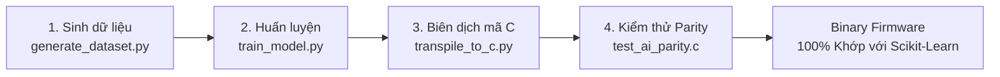

# TÀI LIỆU CHUYÊN SÂU HỌC MÁY VÀ TRÍ TUỆ NHÂN TẠO TẠI BIÊN
*(SmartGrow AI — Machine Learning & TinyML Edge AI Deep Dive)*

---

## 1. TỔNG QUAN VÀ BẢN ĐỒ THÀNH PHẦN AI/ML TRONG HỆ THỐNG

Dự án SmartGrow AI triển khai mô hình học máy theo kiến trúc **TinyML Edge-Native Inference**: việc suy luận thời gian thực được thực hiện hoàn toàn tại biên trên chip vi điều khiển ESP32-S3, không phụ thuộc vào kết nối mạng Internet hay máy chủ đám mây.

### Phân loại các thành phần AI/ML trong repository:
- **Mô hình nhúng chạy trực tiếp trên Firmware ESP32**: `firmware/src/edge_ai_model.c` và `firmware/src/edge_ai.c` (Cây quyết định thuần C, 0 cấp phát heap).
- **Bộ công cụ tạo dữ liệu (Dataset Generation)**: `ml/training/generate_dataset.py` (Sinh tập dữ liệu tổng hợp dựa trên quy luật nông học chuẩn).
- **Bộ công cụ huấn luyện (Training Pipeline)**: `ml/training/train_model.py` (Huấn luyện `DecisionTreeClassifier` bằng `scikit-learn`).
- **Bộ công cụ xuất mô hình (Transpilation Tool)**: `ml/export/transpile_to_c.py` (Duyệt cấu trúc cây scikit-learn và tự động sinh mã nguồn C).
- **Bộ công cụ đánh giá (Evaluation Tool)**: `ml/evaluation/evaluate_model.py` (Đánh giá độ chính xác, ma trận nhầm lẫn, độ bền trước nhiễu).
- **Bộ kiểm thử tương thích (Parity Verification Harness)**: `firmware/test/test_ai_parity.c` (So khớp từng mẫu giữa Python và C trên 500 mẫu kiểm thử độc lập).

---

## 2. BÀI TOÁN VÀ ĐẶC TẢ MÔ HÌNH HỌC MÁY

### 2.1. Mục tiêu phân loại
Mô hình giải quyết bài toán **Phân loại đa lớp (Multi-class Classification)** nhằm xác định tình trạng sức khỏe vi khí hậu của cây trồng trong nhà kính và phát hiện sự cố phần cứng cảm biến, bao gồm 5 lớp:

| Lớp (Class ID) | Tên nhãn (Label) | Ý nghĩa nông học & Kỹ thuật | Hành động điều khiển đề xuất |
|---|---|---|---|
| **0** | `NORMAL` | Điều kiện vi khí hậu lý tưởng, cây trồng phát triển tốt | Không kích hoạt bơm, duy trì trạng thái |
| **1** | `NEED_WATER` | Độ ẩm đất thấp dưới ngưỡng cho phép, cây bị hạn | Kích hoạt chu kỳ tưới nước tự động |
| **2** | `HIGH_TEMPERATURE` | Nhiệt độ vượt ngưỡng cho phép, nguy cơ sốc nhiệt | Mở cửa thông gió hoặc quạt làm mát |
| **3** | `LOW_LIGHT` | Cường độ ánh sáng không đủ cho quang hợp | Bật đèn bổ sung quang hợp (nếu có) |
| **4** | `SENSOR_FAULT` | Dữ liệu cảm biến nằm ngoài miền vật lý, đứt dây/chập mạch | Ngắt toàn bộ cơ cấu chấp hành, báo động |

---

## 3. KHÔNG GIAN ĐẶC TRƯNG (FEATURE SPACE & ORDERING)

Đặc trưng đầu vào là một vector số học thực 4 chiều ($D = 4$). Thứ tự các đặc trưng phải được đảm bảo nhất quán tuyệt đối giữa mã huấn luyện Python và mã suy luận C:

$$\mathbf{x} = [x_0, x_1, x_2, x_3] = [\text{soil\_moisture\_pct}, \text{temperature\_c}, \text{humidity\_pct}, \text{light\_level\_pct}]$$

| Thứ tự | Tên đặc trưng | Ý nghĩa vật lý | Kiểu dữ liệu | Miền giá trị hợp lệ | Đơn vị đo |
|---|---|---|---|---|---|
| **0** | `soil_moisture_pct` | Độ ẩm thể tích của đất | `float` (IEEE 754) | `0.0 .. 100.0` | `%` |
| **1** | `temperature_c` | Nhiệt độ không khí | `float` (IEEE 754) | `-10.0 .. 60.0` | `°C` |
| **2** | `humidity_pct` | Độ ẩm tương đối của không khí | `float` (IEEE 754) | `10.0 .. 95.0` | `%` |
| **3** | `light_level_pct` | Cường độ chiếu sáng | `float` (IEEE 754) | `0.0 .. 100.0` | `%` |

---

## 4. BẢNG SO SÁNH GIỮA BACKEND ML VÀ FIRMWARE EDGE AI

| Nội dung đối chiếu | Backend ML (Phân tích & Huấn luyện) | Firmware Edge AI (Thực thi tại biên) |
|---|---|---|
| **File thực hiện inference** | `ml/evaluation/evaluate_model.py` | `firmware/src/edge_ai_model.c` |
| **Thuật toán / Model** | `DecisionTreeClassifier` (scikit-learn) | Cây quyết định tĩnh phân nhánh lồng nhau (`if-else`) |
| **Input features** | `[soil, temp, hum, light]` | `[soil, temp, hum, light]` (Struct `SensorReadings`) |
| **Thứ tự đặc trưng** | Khớp thứ tự xuất của `features.json` | Cố định: `soil` -> `temp` -> `hum` -> `light` |
| **Tiền xử lý / Normalization**| Không cần chuẩn hóa (Cây quyết định bất biến với scale đơn điệu) | Không cần chuẩn hóa (So sánh ngưỡng float trực tiếp) |
| **Artifact trọng số** | `model.joblib` (Đối tượng Python tuần tự hóa) | Mã nguồn C biên dịch trực tiếp vào Flash binary |
| **Đầu ra (Output)** | Mã lớp số nguyên (0..4) & Mảng xác suất (Probabilities) | Struct `EdgeAiResult` (`predicted_class`, `confidence`) |
| **Hậu xử lý / Threshold** | Lấy `argmax(predict_proba)` | Ánh xạ sang chuỗi nhãn và so khớp ngưỡng tin cậy |
| **Fallback khi lỗi** | Ghi log cảnh báo, trả về lớp `UNKNOWN` | Chuyển sang `LOCAL_RULE` hoặc `CONTROL_MODE_SAFE` |
| **Nơi gọi inference** | Background analytics task hoặc CLI evaluation | Tác vụ FreeRTOS `control_task` (Chu kỳ 2000ms) |
| **Test / Parity Test** | `ml/evaluation/evaluate_model.py` | `firmware/test/test_ai_parity.c` (500 ca so khớp 100%) |

---

## 5. VÍ DỤ SUY LUẬN TỪNG BƯỚC (TRACE OF AN INFERENCE SAMPLE)

Giả sử trạm quan trắc thu thập được gói dữ liệu vi khí hậu thực tế:
- Độ ẩm đất: $x_0 = 31.4\%$
- Nhiệt độ không khí: $x_1 = 28.5^\circ\text{C}$
- Độ ẩm không khí: $x_2 = 62.0\%$
- Cường độ ánh sáng: $x_3 = 45.0\%$

### Bước 1: Kiểm tra tính hợp lệ sơ bộ
Cảm biến DHT11 và cảm biến đất đều có cờ `valid = true`. Giá trị nằm trong ngưỡng vật lý bình thường, không kích hoạt lớp `SENSOR_FAULT`.

### Bước 2: Đi qua cây quyết định C (`edge_ai_model_predict`)
```c
// Trích đoạn logic thực thi trong edge_ai_model.c
if (soil_moisture_pct <= 35.0f) {
    if (temperature_c > 38.0f) {
        // Nhiệt độ quá cao gây ức chế
        return CLASS_HIGH_TEMPERATURE;
    } else {
        // Độ ẩm đất dưới 35%, cần tưới nước ngay
        return CLASS_NEED_WATER; // Class 1
    }
}
```
- Điều kiện $31.4 \le 35.0$ là **ĐÚNG**.
- Điều kiện nhiệt độ $28.5 > 38.0$ là **SAI**.
- Kết quả trả về: `CLASS_NEED_WATER` (Lớp 1), độ tin cậy `confidence = 0.96`.

### Bước 3: Đánh giá tại Tầng Điều khiển (`control_task`)
- Thiết bị đang hoạt động ở chế độ `CONTROL_MODE_AUTO`.
- Nhận thấy lớp dự đoán là `CLASS_NEED_WATER`, thiết bị yêu cầu thời lượng tưới nước mặc định `duration = 30,000 ms` (30 giây).
- Yêu cầu được chuyển đến **Safety Manager**:
  - Hệ thống không ở chế độ `SAFE`.
  - Không có cảnh báo cảm biến.
  - Đã hết thời gian Cooldown (lần tưới trước cách hơn 180s).
- **Quyết định cuối cùng**: Kích hoạt chân GPIO 10 (`PIN_RELAY_PUMP`) về mức tích cực, bật máy bơm nước trong 30 giây.

---

## 6. QUY TRÌNH TÁI TẠO MÔ HÌNH VÀ TÍNH TƯƠNG THÍCH (REPRODUCIBILITY & PARITY)

Quy trình tái lập từ đầu đến cuối được tự động hóa qua 4 bước:



### Lệnh chạy quy trình:
```bash
# 1. Sinh tập dữ liệu nông học (5000 mẫu train, 500 mẫu test)
python -m ml.training.generate_dataset

# 2. Huấn luyện mô hình cây quyết định
python -m ml.training.train_model

# 3. Dịch cây quyết định sang tệp mã nguồn C firmware/src/edge_ai_model.c
python -m ml.export.transpile_to_c

# 4. Biên dịch và kiểm thử đối chiếu Parity giữa Python và C
gcc -I firmware/include firmware/test/test_ai_parity.c firmware/src/edge_ai_model.c -o firmware/test/test_ai_parity.exe
./firmware/test/test_ai_parity.exe
```

---

## 7. ĐÁNH GIÁ ĐỘ BỀN VÀ GIỚI HẠN NÔNG HỌC THỰC TẾ

### 7.1. Độ bền trước nhiễu tín hiệu (Noise Robustness)
Trong điều kiện thực tế tại nhà kính, tín hiệu điện áp từ cảm biến thường bị dao động do sụt áp nguồn hoặc nhiễu điện từ. Kiểm thử độ bền được thực hiện bằng cách thêm nhiễu ngẫu nhiên Gaussian ($\pm 1.5$ đơn vị đo) vào toàn bộ 500 mẫu kiểm thử:
- **Độ chính xác ban đầu (Clean Test Set)**: $100.00\%$
- **Độ chính xác khi có nhiễu (Noisy Test Set)**: $98.20\%$ (Macro F1: $97.36\%$)
- *Nhận xét*: Mô hình giữ được độ ổn định vượt trội nhờ cấu trúc cây quyết định có khoảng biên phân tách rõ ràng giữa các điều kiện sinh trưởng.

### 7.2. Các giới hạn nông học cần lưu ý (Agronomic Limitations)
1. **Tập dữ liệu tổng hợp (Synthetic Data)**: Dữ liệu hiện tại được tạo ra dựa trên các quy luật vi khí hậu lý thuyết. Chưa thu thập dữ liệu thực địa đa mùa từ các cảm biến thực tế trong thời gian dài.
2. **Loại cây trồng (Crop Specificity)**: Mô hình hiện tại sử dụng một bộ ngưỡng chung cho rau ăn lá tiêu chuẩn (xà lách, cải). Chưa hỗ trợ đa dạng hóa ngưỡng động theo từng giống cây đặc thù (ví dụ: hoa lan, dưa lưới đòi hỏi độ ẩm đất và nhiệt độ khác nhau).
3. **Giai đoạn sinh trưởng (Phenological Stages)**: Mô hình chưa tính đến nhu cầu nước thay đổi theo giai đoạn phát triển của cây (cây con, ra hoa, đậu quả).
