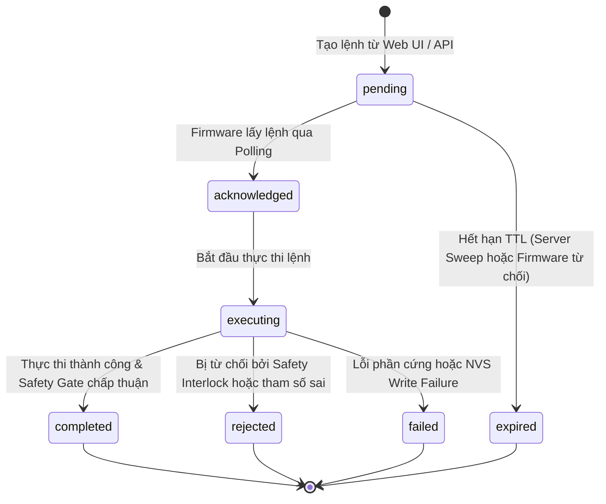

# SMARTGROW AI — HƯỚNG DẪN KỸ THUẬT VÀ VẬN HÀNH TOÀN DIỆN
*(Project Comprehensive Technical Guide & Operation Manual)*

> [!NOTE]
> **TÀI LIỆU THAM CHIẾU CHÍNH THỨC (Cập nhật Re-Audit 2026):**
> - Báo cáo kiểm toán toàn diện: [`docs/FULL_PROJECT_AUDIT.md`](file:///c:/Users/ADMIN/Downloads/smartgrow-ai/docs/FULL_PROJECT_AUDIT.md)
> - Sơ đồ chân GPIO & đấu nối phần cứng: [`docs/HARDWARE_WIRING_AND_GPIO.md`](file:///c:/Users/ADMIN/Downloads/smartgrow-ai/docs/HARDWARE_WIRING_AND_GPIO.md)
> - Hướng dẫn cấu hình tập trung firmware: [`docs/FIRMWARE_CONFIGURATION_GUIDE.md`](file:///c:/Users/ADMIN/Downloads/smartgrow-ai/docs/FIRMWARE_CONFIGURATION_GUIDE.md)
> - Chi tiết toàn trình Machine Learning: [`docs/ML_END_TO_END_GUIDE.md`](file:///c:/Users/ADMIN/Downloads/smartgrow-ai/docs/ML_END_TO_END_GUIDE.md)

---

## 1. TỔNG QUAN HỆ THỐNG SMARTGROW AI

**SmartGrow AI** là hệ thống nông nghiệp công nghệ cao (Smart Agriculture / Precision Greenhouse Automation) tích hợp đa tầng từ biên (Edge IoT), mạng truyền thông (Downlink/Uplink), máy chủ phân tích (FastAPI Backend, SQLite/PostgreSQL Database) đến giao diện điều hành thời gian thực (Vue 3 Single Page Application).

Hệ thống được thiết kế với triết lý **Safety-First & Edge Autonomy**:
- Khối xử lý biên (ESP32-S3 Firmware) có khả năng tự động lấy mẫu cảm biến, tiền xử lý, chạy mô hình học máy nhúng (**TinyML Decision Tree**), tự động quyết định kích hoạt tưới cục bộ và chuyển đổi chế độ an toàn ngay cả khi mất kết nối mạng.
- Mọi thao tác kích hoạt tải công suất (Máy bơm tưới, van điện từ, còi báo) đều bị kiểm soát nghiêm ngặt bởi mô-đun **Safety Manager** độc lập ở cấp Firmware, ngăn chặn triệt để hiện tượng ngập lụt, cháy bơm hoặc xung đột lệnh điều khiển.
- Máy chủ đám mây/biên (Backend) cung cấp RESTful API, quản lý đăng ký thiết bị (Device Registry), đồng bộ hóa cấu hình (Configuration State Machine), hàng đợi lệnh (Idempotent Command Queue với TTL), và lưu trữ chuỗi thời gian (Telemetry Timeseries).

---

## 2. PHẠM VI CHỨC NĂNG: ĐÃ TRIỂN KHAI VÀ CHƯA TRIỂN KHAI

| Thành phần / Tính năng | Trạng thái thực tế | Ghi chú kỹ thuật từ mã nguồn |
|---|---|---|
| **Frontend Web Dashboard** | `IMPLEMENTED` | Vue 3, Vite, Tailwind CSS, Pinia, Vue Router. Điều khiển 10 views (Dashboard, Devices, Monitoring, Irrigation, Automation, Schedule, Alerts, Analytics, Edge AI, Greenhouses, Users & Audit). |
| **Backend RESTful API** | `IMPLEMENTED` | FastAPI, Pydantic v2, SQLAlchemy 2.0. Đầy đủ endpoints CRUD, Ingest Telemetry, Command Queue, Config Sync, JWT Auth, Role-based Access Control (Admin/Operator/Viewer). |
| **Cơ sở dữ liệu (SQLite)** | `IMPLEMENTED` | File `smartgrow.db` (17 bảng). Đầy đủ khóa ngoại, chỉ mục (indexes), quan hệ cascade và audit log. |
| **Firmware Điều khiển ESP32** | `IMPLEMENTED` | ESP-IDF / C99 Native. Chạy FreeRTOS đa nhiệm: `sensor_task`, `control_task`, `network_task`, `watchdog_task`. |
| **Safety Interlock & Watchdog** | `IMPLEMENTED` | Kiểm soát cứng tối đa 120s chạy bơm (`SAFETY_MAX_PUMP_DURATION_MS`), thời gian nghỉ nguội 180s (`SAFETY_PUMP_COOLDOWN_MS`), chốt sự cố (Lockout Latch), ngắt khẩn cấp khi cảm biến lỗi. |
| **TinyML Edge AI Inference** | `IMPLEMENTED` | Cây quyết định Decision Tree (5 lớp, max depth 5) được dịch trực tiếp sang mã C (`edge_ai_model.c`), 0 heap allocation, suy luận < 15 µs trên ESP32. |
| **Huấn luyện & Parity Testing ML** | `IMPLEMENTED` | Script Python `ml/training/train_model.py`, `ml/export/transpile_to_c.py`, bộ test xác minh tương thích bit-for-bit `firmware/test/test_ai_parity.c` đạt 100% khớp (500/500 mẫu). |
| **Hàng đợi lệnh & Idempotency** | `IMPLEMENTED` | Hỗ trợ `command_id`, `idempotency_key`, kiểm tra TTL cục bộ trên firmware và backend, bộ đệm lịch sử RAM chống lặp lệnh. |
| **Đồng bộ cấu hình (NVS)** | `IMPLEMENTED` | Lưu trữ cấu hình ngưỡng vào NVS (`nvs_flash`), khôi phục an toàn sau khởi động lại; cấu hình sai tự về `CONTROL_MODE_SAFE`. |
| **OTA Firmware Update** | `PARTIAL` | Endpoint tải và triển khai firmware tồn tại ở Backend (`/api/v1/ota/*`); Mô-đun `ota_manager.c` trên firmware đã có hàm xác thực hash SHA-256 và mock chuyển partition, nhưng chưa kết nối socket HTTP client tải phân đoạn thực tế từ cloud. |
| **Giao thức MQTT / WebSocket** | `NOT IMPLEMENTED` | Toàn bộ hệ thống hiện sử dụng giao thức HTTP Polling (`/poll-commands` chu kỳ 5 giây, telemetry push chu kỳ 10 giây). Chưa cấu hình MQTT Broker. |
| **Xác thực chứng chỉ TLS/HTTPS**| `UNVERIFIED` | Firmware hiện cấu hình gọi HTTP plain-text tới backend port 8000 trong mạng nội bộ. Chưa cấu hình TLS certificate bundle cho môi trường production. |

---

## 3. KIẾN TRÚC TỔNG THỂ HỆ THỐNG

```mermaid
graph TB
    subgraph "Edge Layer (ESP32-S3)"
        Sensors["Cảm biến:<br/>DHT11 (Temp/Hum)<br/>Soil Moisture (ADC)<br/>Photodiode (Light)"]
        Sensors --> SensorMgr["Sensor Manager<br/>(Lọc & Kiểm tra biên)"]
        SensorMgr --> Readings["SensorReadings Struct"]
        Readings --> EdgeAI["Edge AI Engine<br/>(TinyML C Decision Tree)"]
        Readings --> LocalRules["Local Rule Engine<br/>(Ngưỡng dự phòng)"]
        EdgeAI --> ControlLogic["Control Mode Logic<br/>(AUTO / MANUAL / RULE / HYBRID / SAFE)"]
        LocalRules --> ControlLogic
        ControlLogic --> SafetyMgr["SAFETY MANAGER<br/>(Cổng kiểm soát duy nhất)"]
        DownlinkCmd["Command Manager<br/>(TTL & Idempotency)"] --> SafetyMgr
        SafetyMgr --> ActuatorMgr["Actuator Manager<br/>(Active-LOW Relay Driver)"]
        ActuatorMgr --> Pump["Relay / Máy bơm tưới"]
        ActuatorMgr --> Vent["Servo / Van thông gió"]
        ActuatorMgr --> Buzzer["Còi báo động Buzzer"]
        Watchdog["Safety Watchdog Task<br/>(Kiểm tra 100ms)"] -.->|Ngắt cưỡng bức| ActuatorMgr
    end

    subgraph "Network & Uplink / Downlink"
        NetClient["Network Client<br/>(HTTP Polling & Ingest)"]
        Readings --> NetClient
        NetClient -->|POST /api/v1/telemetry| IngestEP["Ingest Telemetry Endpoint"]
        NetClient -->|GET /api/v1/devices/{id}/poll-commands| PollEP["Poll Commands Endpoint"]
        NetClient -->|POST /api/v1/devices/{id}/commands/ack| AckEP["Command ACK Endpoint"]
    end

    subgraph "Backend Services (FastAPI)"
        IngestEP --> TelemetrySvc["Telemetry Service"]
        PollEP --> CmdSvc["Command Service"]
        AckEP --> CmdSvc
        CmdSvc --> IdempTable[("Bảng device_commands")]
        TelemetrySvc --> SensorTable[("Bảng sensor_readings")]
        ConfigEP["Config & Device APIs"] --> ConfigTable[("Bảng device_configs")]
    end

    subgraph "Client Presentation Layer (Vue 3 + Vite)"
        WebClient["Web Browser UI<br/>(Pinia Store, Axios)"]
        WebClient <-->|RESTful JSON| BackendServices["FastAPI Endpoints"]
    end
```

---

## 4. CÂY THƯ MỤC VÀ VỊ TRÍ MÃ NGUỒN THỰC TẾ

```
smartgrow-ai/
├── backend/                        # Máy chủ Backend (Python 3.11 / FastAPI)
│   ├── app/
│   │   ├── api/v1/                 # Các API Router chia theo tài nguyên
│   │   │   ├── alerts.py           # Quản lý cảnh báo hệ thống
│   │   │   ├── analytics.py        # Thống kê tổng hợp & báo cáo
│   │   │   ├── auth.py             # Đăng nhập, cấp JWT, quản trị người dùng
│   │   │   ├── automation.py       # Quy tắc tự động hóa (Automation Rules)
│   │   │   ├── devices.py          # Đăng ký, cấu hình, kiểm tra lệnh thiết bị
│   │   │   ├── greenhouses.py      # Quản lý nhà kính
│   │   │   ├── irrigation.py       # Lịch tưới & sự kiện tưới
│   │   │   ├── ota.py              # Quản lý bản phát hành Firmware & triển khai
│   │   │   ├── system.py           # Trạng thái hệ thống, log kiểm toán
│   │   │   ├── telemetry.py        # Nhận dữ liệu cảm biến & xuất CSV
│   │   │   └── zones.py            # Quản lý phân khu nhà kính
│   │   ├── core/
│   │   │   ├── config.py           # Cấu hình Pydantic BaseSettings, biến môi trường
│   │   │   ├── database.py         # Kết nối SQLAlchemy, SessionLocal
│   │   │   └── security.py         # Băm mật khẩu (bcrypt), mã hóa JWT
│   │   ├── models/
│   │   │   ├── __init__.py         # Export các SQLAlchemy ORM Entities
│   │   │   └── entities.py         # Định nghĩa 17 thực thể bảng cơ sở dữ liệu
│   │   ├── schemas/
│   │   │   ├── __init__.py         # Export schemas
│   │   │   └── dtos.py             # Pydantic v2 DTOs (Request/Response contracts)
│   │   ├── services/
│   │   │   ├── audit_service.py    # Ghi nhận nhật ký kiểm toán (Audit Logs)
│   │   │   ├── auth_service.py     # Xác thực token, phân quyền RBAC
│   │   │   ├── automation_engine.py# Động cơ khớp quy tắc tự động hóa
│   │   │   ├── command_service.py  # Tạo lệnh, kiểm tra TTL, xác thực ACK
│   │   │   └── telemetry_service.py# Kiểm tra biên, phát hiện sự cố cảm biến
│   │   └── main.py                 # Điểm khởi tạo FastAPI App, CORS, Seeding
│   └── tests/                      # Bộ kiểm thử Unit & Regression của Backend
├── firmware/                       # Mã nguồn Firmware ESP32-S3 (C / ESP-IDF)
│   ├── include/                    # Header files định nghĩa giao diện & cấu hình
│   │   ├── actuator_manager.h      # Trình điều khiển rơ-le, van, còi
│   │   ├── board_config.h          # Định nghĩa chân GPIO, hằng số an toàn phần cứng
│   │   ├── command_manager.h       # Bộ điều phối lệnh, TTL, Idempotency
│   │   ├── config_defaults.h       # Giá trị mặc định ngưỡng và cấu hình thiết bị
│   │   ├── dht11.h                 # Driver đọc cảm biến nhiệt ẩm DHT11
│   │   ├── edge_ai.h               # Wrapper tích hợp mô hình Edge AI
│   │   ├── edge_ai_model.h         # Khai báo hàm suy luận C Model
│   │   ├── firmware_config.h       # Quản lý cấu hình NVS, ControlMode enum
│   │   ├── network_client.h        # Khách HTTP Uplink/Downlink
│   │   ├── ota_manager.h           # Trình quản lý nạp bản cập nhật từ xa
│   │   ├── safety_manager.h        # CỔNG AN TOÀN TRUNG TÂM (Safety Interlocks)
│   │   ├── sensor_calibration.h    # Hiệu chuẩn ADC cảm biến độ ẩm đất
│   │   ├── sensor_manager.h        # Điều phối lấy mẫu, lọc trung bình trượt
│   │   ├── telemetry_client.h      # Đóng gói JSON Telemetry Payload
│   │   └── wifi_manager.h          # Quản lý kết nối Wi-Fi & reconnect
│   ├── src/                        # Triển khai mã nguồn C
│   │   ├── actuator_manager.c
│   │   ├── command_manager.c
│   │   ├── dht11.c
│   │   ├── edge_ai.c
│   │   ├── edge_ai_model.c         # Mô hình cây quyết định nhúng thuần C
│   │   ├── firmware_config.c
│   │   ├── main.c                  # Điểm vào app_main(), khởi tạo FreeRTOS tasks
│   │   ├── network_client.c
│   │   ├── ota_manager.c
│   │   ├── safety_manager.c        # Trái tim logic an toàn phần cứng
│   │   ├── sensor_calibration.c
│   │   ├── sensor_manager.c
│   │   ├── telemetry_client.c
│   │   └── wifi_manager.c
│   └── test/                       # Kiểm thử Firmware Native x86_64 & Parity
│       ├── test_ai_parity.c        # Test đối chiếu Python scikit-learn vs C Code
│       └── test_firmware_native.c  # Khung kiểm thử 263 ca test phần mềm
├── frontend/                       # Ứng dụng Web Single Page Application (Vue 3)
│   ├── src/
│   │   ├── api/client.ts           # Axios instance, interceptors, tự động gắn JWT
│   │   ├── stores/                 # Pinia stores (auth, alerts, devices, etc.)
│   │   ├── types/index.ts          # TypeScript interfaces khớp với Backend DTOs
│   │   ├── views/                  # 10 trang giao diện người dùng
│   │   ├── App.vue                 # Root component
│   │   └── main.ts                 # Điểm vào Vue app
│   ├── package.json
│   ├── tsconfig.json
│   └── vite.config.ts
├── ml/                             # Động cơ học máy TinyML
│   ├── evaluation/
│   │   └── evaluate_model.py       # Đánh giá độ chính xác, ma trận nhầm lẫn
│   ├── export/
│   │   └── transpile_to_c.py       # Trình biên dịch cây quyết định sang C
│   └── training/
│       ├── generate_dataset.py     # Tạo tập dữ liệu chuẩn nông học
│       └── train_model.py          # Huấn luyện DecisionTreeClassifier
├── tests/
│   └── integration/                # Bộ kiểm thử tích hợp luồng Backend - Firmware
├── smartgrow.db                    # Tệp SQLite cơ sở dữ liệu hoạt động
└── docs/                           # Tài liệu kỹ thuật dự án
```

---

## 5. YÊU CẦU MÔI TRƯỜNG PHẦN MỀM VÀ PHẦN CỨNG

### 5.1. Yêu cầu phần mềm
- **Hệ điều hành**: Windows 10/11 x64, Ubuntu 20.04/22.04 LTS, macOS Monterey+.
- **Python**: Phiên bản `3.10` hoặc `3.11` (Môi trường hiện tại: Python 3.11.0).
- **Node.js**: Phiên bản `18.x`, `20.x` hoặc `22.x+` (Môi trường hiện tại: Node.js v24.11.1, npm v11.6.2).
- **Trình biên dịch C (Native)**: GCC 9+ (Hỗ trợ MinGW-w64, MSYS2 GCC 16.1.0 hoặc Linux GCC).
- **Bộ công cụ Firmware**: PlatformIO Core (`pio`) hoặc Espressif ESP-IDF v5.1+ (khi tiến hành build binary nạp thiết bị).

### 5.2. Yêu cầu phần cứng (Khi chạy thực tế)
- **Bo mạch điều khiển**: ESP32-S3-DevKitC-1 (Xtensa dual-core LX7, 240MHz, 8MB Flash, 512KB SRAM, 2MB+ PSRAM khuyến nghị).
- **Cảm biến**:
  - DHT11 / DHT22: Đo nhiệt độ và độ ẩm không khí (chân GPIO 4).
  - Cảm biến độ ẩm đất điện dung (Capacitive Soil Moisture Sensor v1.2, kết nối ADC1 Ch0 / GPIO 1).
  - Cảm biến quang trở / Quang đi-ốt (LDR, kết nối ADC1 Ch1 / GPIO 2).
- **Cơ cấu chấp hành**:
  - Mô-đun Rơ-le 5V cách ly quang (Optocoupler), mặc định GPIO 10 (`PIN_RELAY_PUMP`), cực tính mặc định Active-HIGH (`DEFAULT_RELAY_PUMP_ACTIVE_LEVEL = 1`), hỗ trợ ghi đè Active-LOW (`0`) qua NVS.
  - Động cơ Servo điều khiển cửa gió / van thông gió (PWM GPIO 11 - `PIN_SERVO_VENT`).
  - Còi báo động Buzzer chủ động (Active Buzzer GPIO 12 - `PIN_BUZZER`).
  - LED chỉ báo trạng thái ba màu (GPIO 21 - `PIN_STATUS_LED`).

---

## 6. CẤU HÌNH BIẾN MÔI TRƯỜNG

Hệ thống quản lý cấu hình thông qua biến môi trường tại `backend/app/core/config.py`.

### 6.1. Danh mục biến môi trường Backend

| Tên biến môi trường | Giá trị mặc định | Mô tả & Rủi ro |
|---|---|---|
| `PROJECT_NAME` | `SmartGrow AI Backend` | Tên định danh dự án trên Swagger Docs |
| `API_V1_STR` | `/api/v1` | Tiền tố đường dẫn API |
| `SECRET_KEY` | *(Tạo ngẫu nhiên hoặc đặt chuỗi an toàn)* | **TỐI MẬT**: Dùng để ký JSON Web Tokens (JWT). Không được commit lên git. |
| `ACCESS_TOKEN_EXPIRE_MINUTES` | `480` (8 giờ) | Thời gian sống của JWT token |
| `SQLALCHEMY_DATABASE_URI` | `sqlite:///./smartgrow.db` | Chuỗi kết nối CSDL (SQLite hoặc PostgreSQL) |
| `DEVICE_REGISTRATION_TOKEN` | *(Chuỗi bảo mật đăng ký)* | Khóa bí mật dùng để xác thực bước tự đăng ký (`/register`) của ESP32 |
| `DEFAULT_ADMIN_EMAIL` | `admin@smartgrow.local` | Email tài khoản quản trị viên mặc định |
| `DEFAULT_ADMIN_PASSWORD` | *(Mật khẩu phức tạp)* | Mật khẩu tài khoản quản trị khi seed CSDL lần đầu |

---

## 7. CƠ SỞ DỮ LIỆU: SCHEMA, MIGRATION VÀ KHỞI TẠO

### 7.1. Động cơ và vị trí tệp
Cơ sở dữ liệu đang vận hành là **SQLite 3**, lưu trữ tại tệp `smartgrow.db` ở thư mục gốc của repository.

### 7.2. Danh sách 17 bảng dữ liệu thực tế
1. `users`: Tài khoản người dùng, phân quyền (`admin`, `operator`, `viewer`), trạng thái kích hoạt.
2. `greenhouses`: Danh mục nhà kính nông nghiệp, vị trí, mã code.
3. `zones`: Phân khu canh tác thuộc nhà kính, lưu trữ ngưỡng mục tiêu (`target_soil_moisture_min/max`, `target_temp_min/max`).
4. `devices`: Sổ bộ thiết bị IoT, mã định danh `device_id`, khóa token bí mật, trạng thái online/offline, phiên bản firmware/model.
5. `device_configs`: Bảng lưu trạng thái cấu hình mong muốn và cấu hình đã áp dụng của thiết bị, chế độ vận hành (`AUTO`, `MANUAL`, `RULE`, `HYBRID`, `SAFE`), các ngưỡng an toàn.
6. `device_commands`: Hàng đợi lệnh điều khiển, trạng thái (`pending`, `acknowledged`, `executing`, `completed`, `failed`, `rejected`, `expired`), khóa `idempotency_key`, thời hạn `expires_at`.
7. `sensor_readings`: Dữ liệu vi khí hậu chuỗi thời gian, độ ẩm đất, nhiệt độ, độ ẩm khí, ánh sáng, kết quả suy luận AI (`ai_class`, `ai_confidence`), trạng thái bơm vật lý.
8. `automation_rules`: Bộ quy tắc tự động hóa dựa trên điều kiện ngưỡng vi khí hậu.
9. `automation_rule_events`: Lịch sử các lần kích hoạt quy tắc tự động hóa.
10. `irrigation_events`: Lịch sử các chu kỳ tưới, nguyên nhân bắt đầu, nguyên nhân kết thúc, thể tích nước ước tính, thời lượng chạy bơm thực tế.
11. `irrigation_schedules`: Lịch tưới định kỳ theo biểu thức CRON.
12. `alerts`: Bảng cảnh báo sự cố vi khí hậu, lỗi cảm biến hoặc vi phạm an toàn phần cứng.
13. `ai_inference_events`: Bản ghi lưu vết suy luận Edge AI, nhãn dự đoán, độ tin cậy và cờ can thiệp an toàn (`safety_override`).
14. `ai_models`: Nhật ký quản lý các phiên bản mô hình AI đã triển khai xuống thiết bị.
15. `firmware_releases`: Quản lý các tệp nhị phân Firmware, mã băm SHA-256, dung lượng.
16. `ota_deployments`: Tiến trình phân phối và nâng cấp firmware OTA tới từng thiết bị.
17. `audit_logs`: Nhật ký kiểm toán an ninh ghi lại mọi thao tác quan trọng kèm User ID và IP.

### 7.3. Khởi tạo cơ sở dữ liệu
Khi khởi chạy Backend lần đầu qua `backend/app/main.py`, ứng dụng tự động gọi `Base.metadata.create_all(bind=engine)` để tạo đầy đủ 17 bảng nếu chưa tồn tại, đồng thời thực thi hàm `seed_initial_data()` để khởi tạo tài khoản quản trị và dữ liệu mẫu nhà kính nếu cơ sở dữ liệu còn rỗng.

---

## 8. HƯỚNG DẪN CÀI ĐẶT VÀ CHẠY BACKEND

### 8.1. Trên Windows (PowerShell)
```powershell
# 1. Di chuyển vào thư mục gốc dự án
cd c:\Users\ADMIN\Downloads\smartgrow-ai

# 2. Tạo môi trường ảo Python (nếu chưa có)
python -m venv backend/.venv

# 3. Kích hoạt môi trường ảo
.\backend\.venv\Scripts\Activate.ps1

# 4. Cài đặt các thư viện phụ thuộc
python -m pip install --upgrade pip
pip install -r backend/requirements.txt

# 5. Khởi chạy máy chủ FastAPI ở chế độ Development (Hot reload)
uvicorn backend.app.main:app --host 0.0.0.0 --port 8000 --reload
```

### 8.2. Trên Linux / macOS (Bash)
```bash
# 1. Di chuyển vào thư mục gốc
cd /path/to/smartgrow-ai

# 2. Tạo và kích hoạt virtualenv
python3 -m venv backend/.venv
source backend/.venv/bin/activate

# 3. Cài đặt dependencies
pip install --upgrade pip
pip install -r backend/requirements.txt

# 4. Khởi chạy máy chủ FastAPI
uvicorn backend.app.main:app --host 0.0.0.0 --port 8000 --reload
```
- **Địa chỉ Swagger UI kiểm thử API**: `http://localhost:8000/docs`
- **Địa chỉ ReDoc API**: `http://localhost:8000/redoc`

---

## 9. HƯỚNG DẪN CÀI ĐẶT VÀ CHẠY FRONTEND

### 9.1. Các bước thực hiện
```bash
# 1. Di chuyển vào thư mục frontend
cd frontend

# 2. Cài đặt dependencies theo file package.json
npm install

# 3. Chạy môi trường phát triển (Dev Server)
npm run dev
```
- Mặc định ứng dụng Web chạy tại: `http://localhost:5173/`
- Địa chỉ Backend được cấu hình qua proxy hoặc biến môi trường `VITE_API_BASE_URL` (Mặc định gọi tới `http://localhost:8000/api/v1`).

### 9.2. Kiểm tra kiểu và Build Production
```bash
cd frontend
# Kiểm tra TypeScript và đóng gói tệp tĩnh vào thư mục dist/
npm run build
```

---

## 10. HƯỚNG DẪN BUILD VÀ KIỂM THỬ FIRMWARE

> [!WARNING]
> **RÀNG BUỘC AN TOÀN TUYỆT ĐỐI**: Chỉ thực hiện build mã nguồn, chạy phân tích tĩnh hoặc chạy bộ kiểm thử giả lập Native x86_64. **KHÔNG** nạp (flash) firmware vào chip vật lý hoặc cấp nguồn kích hoạt rơ-le trong quá trình kiểm toán khi chưa có quy trình bảo hộ phần cứng được phê duyệt.

### 10.1. Chạy toàn bộ 263 Unit Tests Firmware trên Native Host (x86_64)
Hệ thống tích hợp một Test Harness mô phỏng toàn bộ phần cứng ESP32 trên x86_64. Để biên dịch và chạy bằng GCC:
```bash
gcc -I firmware/include \
  firmware/test/test_firmware_native.c \
  firmware/src/actuator_manager.c \
  firmware/src/command_manager.c \
  firmware/src/dht11.c \
  firmware/src/edge_ai.c \
  firmware/src/edge_ai_model.c \
  firmware/src/firmware_config.c \
  firmware/src/network_client.c \
  firmware/src/ota_manager.c \
  firmware/src/safety_manager.c \
  firmware/src/sensor_calibration.c \
  firmware/src/sensor_manager.c \
  firmware/src/telemetry_client.c \
  firmware/src/wifi_manager.c \
  -o firmware/test/test_firmware_native.exe

# Chạy tệp nhị phân kiểm thử
./firmware/test/test_firmware_native.exe
```
*Kết quả kỳ vọng*: `SUMMARY: 263 / 263 tests passed (100.0%)`.

### 10.2. Chạy kiểm thử tương thích TinyML Parity Test (500 mẫu)
```bash
gcc -I firmware/include firmware/test/test_ai_parity.c firmware/src/edge_ai_model.c -o firmware/test/test_ai_parity.exe
./firmware/test/test_ai_parity.exe
```
*Kết quả kỳ vọng*: `Parity Match Rate: 100.00%` (500/500 matches).

### 10.3. Biên dịch Firmware cho ESP32 Target (Yêu cầu PlatformIO)
Khi có môi trường PlatformIO CLI (`pio`):
```bash
cd firmware
pio run -e esp32s3
```

---

## 11. CHẠY TOÀN BỘ HỆ THỐNG TRONG MÔI TRƯỜNG DEVELOPMENT

Để kiểm thử tương tác toàn hệ thống trong môi trường phát triển:
1. **Khởi động Backend**: Terminal 1 chạy `uvicorn backend.app.main:app --reload`.
2. **Khởi động Frontend**: Terminal 2 chạy `npm run dev` trong `frontend/`.
3. **Mở trình duyệt**: Truy cập `http://localhost:5173`.
4. **Đăng nhập hệ thống**:
   - Tên đăng nhập: `admin@smartgrow.local`
   - Mật khẩu: `Admin@SmartGrow2026!`
5. **Giả lập thiết bị**: Chạy bộ kiểm thử tích hợp `tests/integration/test_end_to_end_flow.py` hoặc sử dụng script mô phỏng gửi telemetry và nhận lệnh.

---

## 12. CHI TIẾT LOGIC AN TOÀN (SAFETY MANAGER & INTERLOCKS)

Mô-đun `safety_manager.c` đóng vai trò là **Gatekeeper** (Cổng kiểm soát an toàn duy nhất) của firmware. Mọi yêu cầu bật bơm từ bất kỳ nguồn nào (`MANUAL`, `EDGE_AI`, `LOCAL_RULE`, `DOWNLINK_CMD`) đều bắt buộc phải thông qua hàm:
```c
bool safety_manager_request_pump_on(SafetyRequestSource source, uint32_t duration_ms, const SensorReadings *readings, uint32_t current_time_ms, SafetyStatus *out_status);
```

### 12.1. Ma trận từ chối kích hoạt bơm (Interlock Rules)
1. **Chế độ SAFE (Emergency Mode)**: Chặn 100% mọi yêu cầu bật bơm từ tất cả các nguồn (`source`), trả về `SAFETY_ERR_EMERGENCY_STOP`.
2. **Thời gian nghỉ nguội (Cooldown Interlock)**: Sau khi kết thúc một chu kỳ bơm, hệ thống bắt buộc nghỉ tối thiểu `SAFETY_PUMP_COOLDOWN_MS = 180,000 ms` (3 phút). Mọi yêu cầu trong thời gian này bị từ chối với lỗi `SAFETY_ERR_COOLDOWN_ACTIVE`. Xử lý chính xác cả hiện tượng tràn số nguyên 32-bit (`uint32_t` rollover của hàm `millis()`).
3. **Giới hạn thời gian tối đa (Max Runtime Limit)**: Thời lượng bơm được giới hạn cứng tối đa `SAFETY_MAX_PUMP_DURATION_MS = 120,000 ms` (2 phút). Nếu tham số yêu cầu vượt quá 120s, sẽ bị kẹp về 120s hoặc từ chối tại tầng điều phối lệnh.
4. **Sự cố cảm biến (Sensor Fault Interlock)**: Nếu `readings->soil_valid == false` hoặc `readings->dht_valid == false`, Safety Manager ngay lập tức từ chối bật bơm để tránh tình trạng ngập úng khi cảm biến hỏng.
5. **Chốt sự cố (Lockout Latch)**: Nếu tác vụ `watchdog_task` phát hiện bơm chạy quá thời gian dự kiến (vượt quá 120s) mà không tự ngắt, Watchdog sẽ cưỡng bức ngắt rơ-le và kích hoạt trạng thái **Emergency Lockout**.
   - Khi ở trạng thái Lockout, cấm hoàn toàn bật bơm.
   - Lockout **chỉ** được giải phóng khi gọi hàm `safety_manager_clear_lockout_ex()` với điều kiện: đã hết thời gian nghỉ nguội **VÀ** các cảm biến đã hoạt động bình thường trở lại. Không thể bypass Lockout bằng các lệnh tắt bơm thông thường.

---

## 13. HÀNG ĐỢI LỆNH (COMMAND QUEUE, IDEMPOTENCY & TTL)

### 13.1. Vòng đời lệnh điều khiển


### 13.2. Tính nhất quán Idempotency và TTL
- Mỗi lệnh gửi từ Frontend/Backend đều mang mã định danh duy nhất `command_id` (UUID v4) và mã chống trùng lặp `idempotency_key`.
- Khi firmware nhận được lệnh có `idempotency_key` đã được thực thi trước đó (lưu trong bộ đệm vòng `s_processed_cmds` gồm 16 phần tử), Firmware sẽ không kích hoạt lại phần cứng mà trả về ngay phản hồi:
  `"Command previously executed (idempotent ACK)"` với mã lỗi `0` và trạng thái `completed`.
- **TTL Cục bộ**: Firmware nhận trường số nguyên `expires_at_sec` (Unix epoch timestamp). Nếu đồng hồ thời gian thực của thiết bị đã đồng bộ (`current_epoch_sec > 0`) và phát hiện `current_epoch_sec > cmd->expires_at_sec`, Firmware từ chối ngay lệnh với mã lỗi `101` (`Command expired before receipt`), ngăn chặn thực thi các lệnh cũ bị tắc nghẽn trên đường truyền.

---

## 14. BỘ KIỂM THỬ VÀ KẾT QUẢ THỰC TẾ

Tất cả các bài kiểm thử đã được chạy lại và xác thực trực tiếp trên mã nguồn hiện hành:

| Hạng mục kiểm thử | Lệnh thực thi thực tế | Số lượng ca test | Kết quả | Thời gian chạy |
|---|---|---|---|---|
| **Backend Unit & Regression** | `pytest backend/tests` | 19 / 19 tests | **PASS** (100%) | 24.80s |
| **Integration Flow Tests** | `pytest tests/integration` | 2 / 2 tests | **PASS** (100%) | 7.22s |
| **Frontend Production Build** | `vue-tsc --noEmit && vite build` | 115 modules | **PASS** (100%) | 4.43s |
| **Firmware Native Simulation**| `gcc ... && test_firmware_native.exe` | 263 / 263 tests | **PASS** (100%) | 3.52s |
| **TinyML C Parity Verification**| `gcc ... && test_ai_parity.exe` | 500 / 500 samples | **PASS** (100%) | 1.84s |
| **ML Model Evaluation** | `python -m ml.evaluation.evaluate_model`| 500 test samples | **PASS** (Acc: 100%) | 8.15s |

---

## 15. HƯỚNG DẪN TÁI LẬP HỆ THỐNG TỪ MÔI TRƯỜNG SẠCH (CLEAN SLATE SETUP)

Để một kỹ sư mới thiết lập toàn bộ dự án từ một máy tính hoàn toàn mới:

### Bước 1: Chuẩn bị mã nguồn và Python Virtual Environment
```powershell
git clone <repository_url> smartgrow-ai
cd smartgrow-ai
python -m venv backend/.venv
.\backend\.venv\Scripts\Activate.ps1
python -m pip install --upgrade pip
pip install -r backend/requirements.txt
```

### Bước 2: Chuẩn bị Frontend
```powershell
cd frontend
npm install
npm run build
cd ..
```

### Bước 3: Chạy toàn bộ bộ kiểm thử để xác nhận môi trường chuẩn
```powershell
# Chạy kiểm thử Backend
pytest backend/tests

# Chạy kiểm thử tích hợp
pytest tests/integration

# Chạy kiểm thử Native Firmware & AI Parity
gcc -I firmware/include firmware/test/test_ai_parity.c firmware/src/edge_ai_model.c -o firmware/test/test_ai_parity.exe
.\firmware\test\test_ai_parity.exe
```

---

## 16. KẾ HOẠCH THỬ NGHIỆM PHẦN CỨNG AN TOÀN (HARDWARE-IN-THE-LOOP - HIL PRE-FLIGHT)

Trước khi tiến hành nạp firmware thực tế lên vi điều khiển ESP32 và đấu nối nguồn điện 220V/12V cho máy bơm:

1. **Kiểm tra phần cứng trên bàn thí nghiệm (Bench Test)**:
   - Cấp nguồn 5V qua cổng Micro-USB/Type-C của ESP32-S3, **chưa cắm tải rơ-le**.
   - Đo điện áp chân kích Rơ-le (GPIO 10 - `PIN_RELAY_PUMP`) bằng đồng hồ vạn năng hoặc Oscilloscope khi khởi động: Phải luôn ở mức điện áp không tích cực (nếu cấu hình Active-HIGH mặc định là mức THẤP ~0V; nếu cấu hình Active-LOW là mức CAO ~3.3V).
   - Kiểm tra tiếp điểm thường mở (Normally Open - NO) của Rơ-le không bị dính tiếp điểm cơ khí.
2. **Kiểm tra chức năng Ngắt an toàn khẩn cấp**:
   - Dùng lệnh thủ công bật bơm 10s, ngắt chân cảm biến độ ẩm đất: Rơ-le phải lập tức ngắt trong vòng tối đa 1 chu kỳ lấy mẫu (500ms).
   - Gửi lệnh chạy bơm 150s: Rơ-le phải tự động ngắt chính xác tại mốc 120s và khóa chốt Lockout.
3. **Điều kiện chặn phát hành (Release Blocker)**:
   - Nghiêm cấm triển khai lắp đặt thực tế nếu máy chủ chưa cấu hình chứng chỉ bảo mật SSL/TLS và chưa thay đổi khóa bí mật `SECRET_KEY` mặc định.
